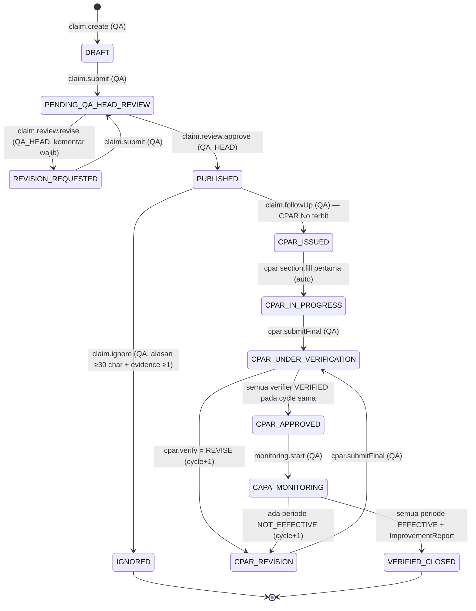

# PLAN.md — NCC Portal (NIFCO Customer Claim)

**PT Nifco Indonesia — Customer Complaint Handling Portal**
Status dokumen: **menunggu persetujuan** (§14.1). Belum ada kode yang ditulis.

Dokumen ini berisi tiga hal yang diminta sebelum implementasi:

1. [Skema Prisma final](#1-skema-prisma-final)
2. [Matriks permission `ACTION × ROLE × STATUS`](#2-matriks-permission-action--role--status)
3. [Diagram state klaim](#3-diagram-state-klaim)

Ditambah lampiran yang menempel erat ke tiga hal di atas: [numbering](#4-numbering--counter),
[matriks notifikasi → kode](#5-matriks-notifikasi--implementasi), [struktur folder](#6-struktur-folder),
[rencana fase](#7-rencana-fase--definition-of-done), dan [pertanyaan terbuka](#8-pertanyaan-yang-perlu-jawaban-anda).

Asumsi yang saya ambil karena aturan bisnisnya tidak eksplisit dicatat di **`ASSUMPTIONS.md`** —
mohon dibaca bersamaan, karena beberapa di antaranya memengaruhi skema di bawah.

---

## 0. Keputusan arsitektur yang perlu Anda tahu sebelum membaca skema

| # | Keputusan | Alasan |
|---|---|---|
| D1 | **`Claim` adalah agregat root tunggal.** `Cpar`, `MonitoringPeriod`, `ImprovementReport` adalah anak dari klaim, bukan entitas berdiri sendiri. | "Satu klaim = satu record hidup" (§1). Semua PDF adalah proyeksi dari agregat ini. |
| D2 | **Status hidup di `Claim.status` saja.** `Cpar` tidak punya status sendiri. | Mencegah dua sumber kebenaran yang bisa desync. Fase CPAR sudah terwakili di `ClaimStatus`. |
| D3 | **`CparSection` adalah baris, bukan kolom.** 7 baris per CPAR, dibuat sekaligus saat CPAR terbit. | Butuh `filledById`/`filledAt`/`lockedAt` per section (§4) + kunci per role. Kolom tidak bisa membawa metadata itu. |
| D4 | **Verifikasi tidak pernah dihapus.** `Verification` unik per `(cparId, role, verifierId, cycle)`; revisi menaikkan `cycle`. | §5 "simpan sebagai riwayat siklus sebelumnya". |
| D5 | **`Attachment` polymorphic** via `(entityType, entityId)` tanpa FK DB, dengan index gabungan. | Diminta §4. Konsekuensi: integritas dijaga di layer aplikasi (helper `attachTo()`), bukan constraint. |
| D6 | **Snapshot PDF disimpan** di `GeneratedDocument.snapshot Json`. | §4 "PDF lama tetap merefleksikan isi saat itu". PDF di-regenerate dari snapshot, bukan dari data live. |
| D7 | **Soft delete global** (`deletedAt`), diterapkan lewat Prisma Client Extension agar tidak bisa lupa. | §4. Query default otomatis `deletedAt: null`. |
| D8 | **State machine adalah satu-satunya pintu perubahan status.** Server action tidak boleh `prisma.claim.update({ status })` langsung; wajib lewat `transitionClaim()`. | Kriteria penerimaan #3 & #8 — audit log dan notifikasi ikut di dalam transaksi yang sama. |

---

## 1. Skema Prisma final

```prisma
// prisma/schema.prisma
generator client {
  provider = "prisma-client-js"
}

datasource db {
  provider = "postgresql"
  url      = env("DATABASE_URL")
}

// ───────────────────────────── ENUMS ─────────────────────────────

enum RoleCode {
  QA
  QA_HEAD
  USER_DEPT
  USER_HEAD
  FACTORY_MGR
  PRESDIR
  ADMIN
}

enum ClaimStatus {
  DRAFT
  PENDING_QA_HEAD_REVIEW
  REVISION_REQUESTED
  PUBLISHED
  IGNORED                  // terminal
  CPAR_ISSUED
  CPAR_IN_PROGRESS
  CPAR_UNDER_VERIFICATION
  CPAR_REVISION
  CPAR_APPROVED
  CAPA_MONITORING
  VERIFIED_CLOSED          // terminal
}

enum ClaimType {
  OFFICIAL
  NON_OFFICIAL
  INFORMATION_ONLY
}

enum Shift {
  MORNING
  NIGHT
}

enum FailurePlaceType {
  REGULAR
  DOMESTIC
  EXPORT
  SERVICE_PART
}

enum OriginPlantType {
  NID
  PASSTHROUGH
  VENDOR_SUBCON
}

enum OccurrenceCount {
  FIRST_TIME
  SECOND_TIME
  THIRD_OR_MORE
}

enum PartSide {
  STANDARD
  ACTUAL
}

enum QtyUnit {
  PCS
  BOX
}

enum ResponsibilityType {
  CFT
  USER_DEPT
}

enum CparSectionKey {
  PROBLEM_DESCRIPTION
  TEMPORARY_ACTION
  ROOT_CAUSE_OCCURRENCE
  ROOT_CAUSE_OUTFLOW
  PERMANENT_COUNTERMEASURE
  STANDARDIZATION_HORIZONTAL
  EFFECTIVENESS_PLAN
}

enum VerificationDecision {
  VERIFIED
  REVISE
}

enum MonitoringStatus {
  PENDING
  EFFECTIVE
  NOT_EFFECTIVE
}

enum DocumentKind {
  BAD_NEWS
  QUICK_INFO
  CPAR
  MONITORING
  A3
}

enum NotificationType {
  CLAIM_REVIEW_REQUEST            // #1
  CLAIM_REVISION_REQUEST          // #2
  NEW_CUSTOMER_CLAIM              // #3
  CPAR_REQUEST                    // #4
  CLAIM_IGNORATION                // #5
  CPAR_DAILY_REMINDER             // #6
  CPAR_REVIEW_REQUEST             // #7
  CPAR_REVIEW_REMINDER            // #8
  CPAR_REVISION_REQUEST           // #9
  CPAR_APPROVED                   // #10
  MONITORING_EVIDENCE_REQUEST     // #11
  MONITORING_WEEKLY_REMINDER      // #12
  CAPA_NOT_EFFECTIVE              // #13
  MONITORING_FINISHED             // #14
}

enum NotificationStatus {
  QUEUED
  SENT
  FAILED
}

enum CounterScope {
  CLAIM
  CPAR
}

// ─────────────────────── IDENTITY & ORG ───────────────────────

model Department {
  id        String   @id @default(cuid())
  code      String   @unique            // "PRD", "QA", "ENG", "PPIC", "MTC", "WH"
  name      String
  email     String?                      // milis departemen, ikut jadi penerima notifikasi
  isActive  Boolean  @default(true)

  users             User[]
  responsibleCpars  Cpar[]              @relation("CparResponsibleDept")
  cftMemberships    CparCftMember[]

  createdAt DateTime  @default(now())
  updatedAt DateTime  @updatedAt
  deletedAt DateTime?

  @@index([deletedAt])
}

model Role {
  id        String   @id @default(cuid())
  code      RoleCode @unique
  name      String
  users     UserRole[]

  createdAt DateTime  @default(now())
  updatedAt DateTime  @updatedAt
  deletedAt DateTime?
}

model User {
  id           String  @id @default(cuid())
  employeeNo   String? @unique
  name         String
  email        String  @unique
  passwordHash String
  jobTitle     String                    // dicetak di blok tanda tangan PDF
  departmentId String?
  department   Department? @relation(fields: [departmentId], references: [id])
  isActive     Boolean @default(true)
  lastLoginAt  DateTime?

  roles          UserRole[]
  createdClaims  Claim[]        @relation("ClaimCreatedBy")
  verifications  Verification[]
  auditLogs      AuditLog[]
  attachments    Attachment[]
  sections       CparSection[]
  monitoringFills MonitoringPeriod[]    @relation("MonitoringFilledBy")

  createdAt DateTime  @default(now())
  updatedAt DateTime  @updatedAt
  deletedAt DateTime?

  @@index([departmentId])
  @@index([deletedAt])
}

model UserRole {
  userId String
  roleId String
  user   User @relation(fields: [userId], references: [id], onDelete: Cascade)
  role   Role @relation(fields: [roleId], references: [id], onDelete: Cascade)

  createdAt DateTime @default(now())

  @@id([userId, roleId])
  @@index([roleId])
}

// ─────────────────────── MASTER DATA ───────────────────────

model NonConformanceDetail {
  id       String  @id @default(cuid())
  code     String  @unique           // POST_INJECTION_DEFECT, CRACK_BROKEN, ...
  name     String                    // "Post Injection Defect"
  sortOrder Int    @default(0)
  isActive Boolean @default(true)
  claims   Claim[]

  createdAt DateTime  @default(now())
  updatedAt DateTime  @updatedAt
  deletedAt DateTime?
}

model ProductCategory {
  id        String  @id @default(cuid())
  code      String  @unique          // CRITICAL_PART | IMPORTANT_PART | GENERAL_PART
  name      String
  sortOrder Int     @default(0)
  isActive  Boolean @default(true)
  claims    Claim[]

  createdAt DateTime  @default(now())
  updatedAt DateTime  @updatedAt
  deletedAt DateTime?
}

model InitialDocument {
  id        String  @id @default(cuid())
  code      String  @unique          // 4M_CHANGE_SHEET, INSPECTION_STANDARD, ...
  name      String
  sortOrder Int     @default(0)
  isActive  Boolean @default(true)
  requests  CparInitialDocument[]

  createdAt DateTime  @default(now())
  updatedAt DateTime  @updatedAt
  deletedAt DateTime?
}

model Customer {
  id       String  @id @default(cuid())
  code     String  @unique
  name     String
  isActive Boolean @default(true)
  claims   Claim[]

  createdAt DateTime  @default(now())
  updatedAt DateTime  @updatedAt
  deletedAt DateTime?
}

model Part {
  id             String  @id @default(cuid())
  internalPartNo String  @unique
  customerPartNo String?
  name           String
  isActive       Boolean @default(true)

  createdAt DateTime  @default(now())
  updatedAt DateTime  @updatedAt
  deletedAt DateTime?

  @@index([customerPartNo])
}

/// Grup penerima untuk email broadcast ("seluruh user portal", "verifier", dst).
model RecipientGroup {
  id      String @id @default(cuid())
  code    String @unique              // ALL_PORTAL_USERS, QA_TEAM, MANAGEMENT
  name    String
  /// Ekspansi dinamis: role apa saja yang masuk grup ini.
  roleCodes RoleCode[]
  /// Alamat tambahan di luar user portal (mis. milis mutu).
  extraEmails String[]
  isActive Boolean @default(true)

  createdAt DateTime  @default(now())
  updatedAt DateTime  @updatedAt
  deletedAt DateTime?
}

/// Subject/heading email dapat diedit admin tanpa deploy; body tetap React Email.
model EmailTemplate {
  id            String           @id @default(cuid())
  type          NotificationType @unique
  subject       String           // Handlebars-lite: "{{claimNo}} — Review Request"
  heading       String
  bodyIntro     String
  ctaLabel      String           @default("Open in portal")
  recipientGroupId String?
  isActive      Boolean          @default(true)

  createdAt DateTime  @default(now())
  updatedAt DateTime  @updatedAt
  deletedAt DateTime?
}

// ─────────────────────── CLAIM (§7) ───────────────────────

model Claim {
  id       String      @id @default(cuid())
  claimNo  String?     @unique          // null selama DRAFT, terbit saat submit
  status   ClaimStatus @default(DRAFT)
  type     ClaimType

  // A. Claim Information
  dateOfOccurrence   DateTime
  shiftOfOccurrence  Shift
  dateOfReceived     DateTime
  shiftOfReceived    Shift
  failurePlace       String
  failurePlaceType   FailurePlaceType
  contactPerson      String
  contactEmail       String
  contactPhone       String
  internalPartNo     String
  customerPartNo     String
  partName           String
  productCategoryId  String
  productCategory    ProductCategory @relation(fields: [productCategoryId], references: [id])
  originPlantType    OriginPlantType
  originPlantDetail  String?           // wajib bila PASSTHROUGH / VENDOR_SUBCON
  occurrence         OccurrenceCount
  ncDetailId         String
  ncDetail           NonConformanceDetail @relation(fields: [ncDetailId], references: [id])
  customerId         String?
  customer           Customer? @relation(fields: [customerId], references: [id])

  // B. Abnormal Description
  abnormalSource      String
  qualityProblem      String
  lotNo               String
  kanbanNo            String
  injectionDate       DateTime?
  assemblyDate        DateTime?
  deliveryDate        DateTime?
  suspectedProcessLine String

  // Review QA Head
  submittedAt      DateTime?
  reviewedById     String?
  reviewedAt       DateTime?
  reviewComment    String?             // wajib saat Request revision
  publishedAt      DateTime?

  // Jalur Ignore
  ignorationReason String?             // min 30 char
  ignoredAt        DateTime?
  ignoredById      String?

  closedAt         DateTime?
  createdById      String
  createdBy        User @relation("ClaimCreatedBy", fields: [createdById], references: [id])

  parts        ClaimPart[]
  cpar         Cpar?
  monitoring   MonitoringPeriod[]
  reports      ImprovementReport[]
  notifications Notification[]
  documents    GeneratedDocument[]

  createdAt DateTime  @default(now())
  updatedAt DateTime  @updatedAt
  deletedAt DateTime?

  @@index([status])
  @@index([type])
  @@index([createdById])
  @@index([dateOfOccurrence])
  @@index([internalPartNo])
  @@index([deletedAt])
}

/// C. Part Comparison — minimal 1 STANDARD + 1 ACTUAL per klaim (divalidasi di Zod + server).
model ClaimPart {
  id             String   @id @default(cuid())
  claimId        String
  claim          Claim    @relation(fields: [claimId], references: [id], onDelete: Cascade)
  side           PartSide
  photoCaption   String?
  partName       String
  nidPartNo      String
  qty            Decimal  @db.Decimal(12, 2)
  qtyUnit        QtyUnit
  dimensionItem  String?
  appearanceItem String?

  createdAt DateTime  @default(now())
  updatedAt DateTime  @updatedAt
  deletedAt DateTime?

  @@unique([claimId, side])
  @@index([claimId])
}

// ─────────────────────── CPAR (§6 Modul 2–3) ───────────────────────

model Cpar {
  id      String @id @default(cuid())
  claimId String @unique
  claim   Claim  @relation(fields: [claimId], references: [id], onDelete: Cascade)
  cparNo  String @unique

  responsibilityType ResponsibilityType
  responsibleDeptId  String
  responsibleDept    Department @relation("CparResponsibleDept", fields: [responsibleDeptId], references: [id])
  cftMembers         CparCftMember[]
  initialDocuments   CparInitialDocument[]

  dueDate      DateTime            // default H+3 hari kerja
  issuedAt     DateTime  @default(now())
  /// Siklus verifikasi berjalan. Naik 1 setiap REVISE atau periode NOT_EFFECTIVE.
  cycle        Int       @default(1)
  submittedAt  DateTime?           // submit final report siklus berjalan
  approvedAt   DateTime?

  sections      CparSection[]
  verifications Verification[]

  createdAt DateTime  @default(now())
  updatedAt DateTime  @updatedAt
  deletedAt DateTime?

  @@index([responsibleDeptId])
  @@index([dueDate])
}

model CparCftMember {
  cparId       String
  departmentId String
  cpar         Cpar       @relation(fields: [cparId], references: [id], onDelete: Cascade)
  department   Department @relation(fields: [departmentId], references: [id])

  @@id([cparId, departmentId])
  @@index([departmentId])
}

model CparInitialDocument {
  cparId            String
  initialDocumentId String
  /// Dicentang saat dokumen benar-benar dilampirkan.
  fulfilledAt       DateTime?
  cpar              Cpar            @relation(fields: [cparId], references: [id], onDelete: Cascade)
  initialDocument   InitialDocument @relation(fields: [initialDocumentId], references: [id])

  @@id([cparId, initialDocumentId])
}

model CparSection {
  id        String         @id @default(cuid())
  cparId    String
  cpar      Cpar           @relation(fields: [cparId], references: [id], onDelete: Cascade)
  key       CparSectionKey
  content   String?        @db.Text
  /// Data terstruktur opsional (5-why, tabel 4M) tanpa migrasi baru.
  data      Json?
  isRequired Boolean       @default(true)
  filledById String?
  filledBy   User?         @relation(fields: [filledById], references: [id])
  filledAt   DateTime?
  lockedAt   DateTime?     // di-set saat submit final; dibuka lagi saat CPAR_REVISION
  /// Section ini ditandai perlu revisi oleh verifier pada siklus terakhir.
  revisionNote String?

  createdAt DateTime  @default(now())
  updatedAt DateTime  @updatedAt
  deletedAt DateTime?

  @@unique([cparId, key])
  @@index([cparId])
}

model Verification {
  id         String               @id @default(cuid())
  cparId     String
  cpar       Cpar                 @relation(fields: [cparId], references: [id], onDelete: Cascade)
  role       RoleCode             // kapasitas saat memverifikasi (bukan seluruh role user)
  verifierId String
  verifier   User                 @relation(fields: [verifierId], references: [id])
  decision   VerificationDecision
  comment    String?              // wajib bila REVISE
  /// Section yang ditandai bermasalah (opsional).
  targetSections CparSectionKey[]
  cycle      Int
  decidedAt  DateTime             @default(now())

  createdAt DateTime  @default(now())
  updatedAt DateTime  @updatedAt
  deletedAt DateTime?

  @@unique([cparId, role, cycle])   // satu keputusan per role per siklus
  @@index([cparId, cycle])
}

// ─────────────────────── MONITORING (§6 Modul 4) ───────────────────────

model MonitoringPeriod {
  id         String           @id @default(cuid())
  claimId    String
  claim      Claim            @relation(fields: [claimId], references: [id], onDelete: Cascade)
  /// Siklus CPAR saat periode ini dibuat — periode lama tetap terbaca setelah revisi.
  cycle      Int              @default(1)
  periodNo   Int
  openedAt   DateTime?
  dueDate    DateTime
  status     MonitoringStatus @default(PENDING)
  note       String?
  filledById String?
  filledBy   User?            @relation("MonitoringFilledBy", fields: [filledById], references: [id])
  filledAt   DateTime?

  createdAt DateTime  @default(now())
  updatedAt DateTime  @updatedAt
  deletedAt DateTime?

  @@unique([claimId, cycle, periodNo])
  @@index([claimId, status])
  @@index([dueDate])
}

model ImprovementReport {
  id        String   @id @default(cuid())
  claimId   String
  claim     Claim    @relation(fields: [claimId], references: [id], onDelete: Cascade)
  cycle     Int      @default(1)
  summary   String   @db.Text
  lessonLearned String? @db.Text
  a3Content Json?              // blok A3: background, target, analysis, plan, result
  submittedById String
  submittedAt   DateTime @default(now())

  createdAt DateTime  @default(now())
  updatedAt DateTime  @updatedAt
  deletedAt DateTime?

  @@index([claimId])
}

// ─────────────────────── SHARED ───────────────────────

model Attachment {
  id           String  @id @default(cuid())
  entityType   String  // "Claim" | "ClaimPart" | "CparSection" | "MonitoringPeriod" | "ImprovementReport"
  entityId     String
  originalName String
  mimeType     String
  size         Int
  path         String  // relatif terhadap STORAGE_ROOT → /storage/uploads/{claimNo}/...
  caption      String?
  /// Denormalisasi untuk scoping izin & pembersihan tanpa join berantai.
  claimId      String?
  uploadedById String
  uploadedBy   User    @relation(fields: [uploadedById], references: [id])

  createdAt DateTime  @default(now())
  updatedAt DateTime  @updatedAt
  deletedAt DateTime?

  @@index([entityType, entityId])
  @@index([claimId])
}

/// Snapshot PDF (D6) — satu baris per dokumen yang pernah dicetak.
model GeneratedDocument {
  id        String       @id @default(cuid())
  claimId   String
  claim     Claim        @relation(fields: [claimId], references: [id], onDelete: Cascade)
  kind      DocumentKind
  version   Int          @default(1)
  cycle     Int          @default(1)
  path      String
  snapshot  Json         // isi klaim/CPAR saat dicetak
  isDraft   Boolean      @default(false)   // watermark "DRAFT"
  generatedById String?
  generatedAt   DateTime @default(now())

  createdAt DateTime  @default(now())
  updatedAt DateTime  @updatedAt
  deletedAt DateTime?

  @@unique([claimId, kind, cycle, version])
  @@index([claimId])
}

model Notification {
  id           String             @id @default(cuid())
  claimId      String?
  claim        Claim?             @relation(fields: [claimId], references: [id])
  type         NotificationType
  recipients   String[]
  ccRecipients String[]
  subject      String
  /// Idempotensi (§8): mis. "CPAR_DAILY_REMINDER:claim_x:2026-08-09"
  dedupeKey    String             @unique
  status       NotificationStatus @default(QUEUED)
  attempts     Int                @default(0)
  sentAt       DateTime?
  errorMessage String?
  payload      Json?              // props yang dipakai template React Email
  attachmentPaths String[]

  createdAt DateTime  @default(now())
  updatedAt DateTime  @updatedAt
  deletedAt DateTime?

  @@index([claimId])
  @@index([status])
  @@index([type, createdAt])
}

model AuditLog {
  id          String   @id @default(cuid())
  actorId     String?
  actor       User?    @relation(fields: [actorId], references: [id])
  entityType  String
  entityId    String
  claimId     String?              // agar timeline detail klaim cukup satu query
  action      String               // "claim.submit", "cpar.verify", ...
  fromStatus  ClaimStatus?
  toStatus    ClaimStatus?
  payloadDiff Json?
  ipAddress   String?
  userAgent   String?
  createdAt   DateTime @default(now())

  @@index([claimId, createdAt])
  @@index([entityType, entityId])
}

/// Generator nomor aman race-condition: SELECT ... FOR UPDATE di dalam transaksi.
model Counter {
  id      String       @id @default(cuid())
  scope   CounterScope
  /// CLAIM → "26-08" (per bulan), CPAR → "26" (per tahun)
  bucket  String
  value   Int          @default(0)

  createdAt DateTime @default(now())
  updatedAt DateTime @updatedAt

  @@unique([scope, bucket])
}
```

### Catatan skema

- `Session`/`VerificationToken` Auth.js **tidak dibuat** — strategi session JWT (§2), tidak butuh tabel.
- `Role.deletedAt` ada demi konsistensi §4, tapi role tidak pernah dihapus (7 role tetap, di-seed).
- `Claim.claimNo` nullable saat `DRAFT`; unik saat terbit. Draft muncul di list sebagai `DRAFT-{6 char id}`.
- `ClaimPart` `@@unique([claimId, side])` → tepat satu panel Standard dan satu panel Actual (§7C dua panel berdampingan). Foto banyak per panel lewat `Attachment`.
- `MonitoringPeriod` dikunci per `cycle`, jadi saat `Not Effective` memicu siklus baru, periode siklus lama tetap terbaca di timeline (kriteria penerimaan #2).

---

## 2. Matriks permission `ACTION × ROLE × STATUS`

Sumber kebenaran tunggal: **`src/lib/permissions.ts`**, diekspor sebagai konstanta bertipe yang dibaca
oleh middleware, server action (`can(user, action, claim)`), dan render tombol. Tabel di bawah adalah
representasi manusiawi dari konstanta itu — keduanya harus selalu sama; ada unit test yang membandingkan
tabel ini (di-parse dari fixture) dengan objek runtime.

### 2.1 Scope visibilitas (dievaluasi sebelum action apa pun)

| Role | Klaim yang terlihat |
|---|---|
| `QA`, `QA_HEAD`, `FACTORY_MGR`, `PRESDIR`, `ADMIN` | semua |
| `USER_DEPT`, `USER_HEAD` | hanya klaim dengan `cpar.responsibleDeptId = user.departmentId` **atau** dept-nya ada di `cpar.cftMembers` |

Klaim tanpa CPAR (`DRAFT`…`PUBLISHED`, `IGNORED`) **tidak** terlihat oleh `USER_DEPT`/`USER_HEAD`,
**kecuali** statusnya `PUBLISHED`/`IGNORED` — karena keduanya memicu broadcast "seluruh user portal" (§8 #3, #5),
jadi menyembunyikannya dari portal setelah emailnya dikirim tidak masuk akal. → dicatat di `ASSUMPTIONS.md` A-07.

Pelanggaran scope → **403** (kriteria penerimaan #4), bukan 404.

### 2.2 Matriks aksi

Legenda: ✅ boleh · `o` hanya pemilik/pembuat · `d` hanya dept terkait · `—` tidak boleh.
Kolom **Status** = status klaim yang mengizinkan aksi; di status lain aksi selalu ditolak.

| # | ACTION | Status yang diizinkan | QA | QA_HEAD | USER_DEPT | USER_HEAD | FACTORY_MGR | PRESDIR | ADMIN |
|---|---|---|:--:|:--:|:--:|:--:|:--:|:--:|:--:|
| 1 | `claim.create` | — (baru) | ✅ | ✅ | — | — | — | — | ✅ |
| 2 | `claim.update` | `DRAFT`, `REVISION_REQUESTED` | o | — | — | — | — | — | ✅ |
| 3 | `claim.submit` | `DRAFT`, `REVISION_REQUESTED` | o | — | — | — | — | — | ✅ |
| 4 | `claim.review.approve` | `PENDING_QA_HEAD_REVIEW` | — | ✅ | — | — | — | — | — |
| 5 | `claim.review.revise` | `PENDING_QA_HEAD_REVIEW` | — | ✅ | — | — | — | — | — |
| 6 | `claim.followUp` *(Action Button A)* | `PUBLISHED` | ✅ | ✅ | — | — | — | — | — |
| 7 | `claim.ignore` | `PUBLISHED` | ✅ | ✅ | — | — | — | — | — |
| 8 | `cpar.view` *(Action Button B)* | `CPAR_ISSUED`→`VERIFIED_CLOSED` | ✅ | ✅ | d | d | ✅ | ✅ | ✅ |
| 9 | `cpar.section.fill` | `CPAR_ISSUED`, `CPAR_IN_PROGRESS`, `CPAR_REVISION` | per section — lihat §2.3 |
| 10 | `cpar.evidence.upload` | idem #9 | ✅ | ✅ | d | d | ✅ | ✅ | ✅ |
| 11 | `cpar.submitFinal` | `CPAR_IN_PROGRESS`, `CPAR_REVISION` | ✅ | ✅ | — | — | — | — | ✅ |
| 12 | `cpar.verify` | `CPAR_UNDER_VERIFICATION` | — | ✅ | — | d | ✅ | ✅ | — |
| 13 | `cpar.print` | ≥ `CPAR_IN_PROGRESS` | ✅ | ✅ | d | d | ✅ | ✅ | ✅ |
| 14 | `monitoring.start` *(Action Button C)* | `CPAR_APPROVED` | ✅ | ✅ | — | — | — | — | ✅ |
| 15 | `monitoring.evidence.upload` | `CAPA_MONITORING` | ✅ | — | d | d | — | — | ✅ |
| 16 | `monitoring.setEffectiveness` | `CAPA_MONITORING` | — | — | — | — | ✅ | ✅ | — |
| 17 | `monitoring.submitReport` | `CAPA_MONITORING` (semua periode `EFFECTIVE`) | ✅ | ✅ | — | — | — | — | ✅ |
| 18 | `claim.export` | semua | ✅ | ✅ | d | d | ✅ | ✅ | ✅ |
| 19 | `master.manage` | — | — | — | — | — | — | — | ✅ |
| 20 | `user.manage` | — | — | — | — | — | — | — | ✅ |
| 21 | `notification.viewLog` | — | — | ✅ | — | — | — | — | ✅ |
| 22 | `audit.view` | semua | ✅ | ✅ | d | d | ✅ | ✅ | ✅ |

Catatan penting:

- Baris 4/5: `ADMIN` sengaja **tidak** bisa approve klaim. Admin mengelola sistem, bukan memutuskan mutu —
  kalau tidak, jejak approval di PDF jadi tidak bermakna. Bisa diubah kalau Anda mau (lihat §8 Q4).
- Baris 12: `ADMIN` juga tidak bisa memverifikasi CPAR, alasan sama.
- Baris 16: `FACTORY_MGR` dan `PRESDIR` sama-sama boleh mengisi efektivitas; siapa pun yang duluan mengunci periode.
- `IGNORED` dan `VERIFIED_CLOSED` terminal → hanya aksi baca (`*.view`, `*.print`, `claim.export`, `audit.view`).

### 2.3 Peta section CPAR → role pengisi

Diminta §6 Modul 3 ("section yang bukan haknya tampil read-only"). Spec tidak menyebut pemetaannya,
jadi ini **usulan saya** (asumsi A-03) dan sengaja dibuat sebagai konstanta `CPAR_SECTION_OWNERS`
yang gampang diubah tanpa menyentuh logika.

| Section | Boleh mengisi | Wajib? |
|---|---|:--:|
| `PROBLEM_DESCRIPTION` | `QA` | ✅ |
| `TEMPORARY_ACTION` | `USER_DEPT` (dept terkait), `QA` | ✅ |
| `ROOT_CAUSE_OCCURRENCE` | `USER_DEPT` (dept terkait) | ✅ |
| `ROOT_CAUSE_OUTFLOW` | `USER_DEPT` (dept terkait) | ✅ |
| `PERMANENT_COUNTERMEASURE` | `USER_DEPT` (dept terkait) | ✅ |
| `STANDARDIZATION_HORIZONTAL` | `USER_DEPT`, `USER_HEAD` (dept terkait) | ✅ |
| `EFFECTIVENESS_PLAN` | `USER_HEAD` (dept terkait), `QA` | ✅ |

`ADMIN` read-only di semua section. `FACTORY_MGR`/`PRESDIR` read-only saat pengisian — kontribusi mereka
masuk lewat `cpar.verify` dan `monitoring.setEffectiveness`. (Spec §6 menyebut mereka ikut "mengisi";
kalau maksudnya betul-betul mengisi section, sebutkan section mana → §8 Q2.)

### 2.4 Verifier wajib per siklus

`CPAR_UNDER_VERIFICATION → CPAR_APPROVED` hanya bila **semua** baris berikut ada dengan `decision = VERIFIED`
pada `cycle` yang sama:

| Kapasitas | Siapa |
|---|---|
| `QA_HEAD` | user ber-role `QA_HEAD` |
| `USER_HEAD` | user ber-role `USER_HEAD` di `cpar.responsibleDeptId` |
| `FACTORY_MGR` | user ber-role `FACTORY_MGR` |
| `PRESDIR` | user ber-role `PRESDIR` |

Untuk `responsibilityType = CFT`, `responsibleDeptId` berperan sebagai **lead dept**, dan hanya head lead
dept yang jadi verifier wajib (asumsi A-04, lihat §8 Q1). Head dept CFT lain tetap bisa mengisi & melihat.

Set verifier dihitung oleh `requiredVerifiers(cpar)` dan **dibekukan** ke `Notification.payload` saat
siklus dibuka, supaya perubahan master data di tengah jalan tidak mengubah syarat approval siklus berjalan.

### 2.5 Tiga lapis penegakan

1. **Middleware** (`src/middleware.ts`) — cek sesi + role kasar per prefix route (`/master/*` → `ADMIN`).
2. **Server action** — `assertCan(user, action, claim)` melempar `ForbiddenError` → 403.
   Wajib dipanggil **sebelum** `assertTransition`. Ini yang memenuhi kriteria penerimaan #3 & #4.
3. **UI** — `useCan()` / `<Can action=... claim=...>` hanya menyembunyikan tombol. Bukan pengaman.

---

## 3. Diagram state klaim

Implementasi: `src/lib/claim-state.ts`, objek `TRANSITIONS` yang eksplisit + `assertTransition(from, to, actorRoles, claim)`.



### 3.1 Tabel transisi (bentuk kode)

| From | To | Action | Role | Guard tambahan |
|---|---|---|---|---|
| `DRAFT` | `PENDING_QA_HEAD_REVIEW` | `claim.submit` | QA | Zod §7 lolos · ≥1 foto sisi Actual · `dateOfReceived ≥ dateOfOccurrence` · `deliveryDate ≥ productionDate` |
| `REVISION_REQUESTED` | `PENDING_QA_HEAD_REVIEW` | `claim.submit` | QA | idem |
| `PENDING_QA_HEAD_REVIEW` | `REVISION_REQUESTED` | `claim.review.revise` | QA_HEAD | `reviewComment` tidak kosong |
| `PENDING_QA_HEAD_REVIEW` | `PUBLISHED` | `claim.review.approve` | QA_HEAD | — |
| `PUBLISHED` | `CPAR_ISSUED` | `claim.followUp` | QA | responsibleDept terisi · ≥1 initial document · dueDate ≥ hari ini |
| `PUBLISHED` | `IGNORED` | `claim.ignore` | QA | alasan ≥30 char · ≥1 evidence · **`type = INFORMATION_ONLY` bebas; `OFFICIAL`/`NON_OFFICIAL` perlu konfirmasi ganda** (A-02) |
| `CPAR_ISSUED` | `CPAR_IN_PROGRESS` | `cpar.section.fill` | pengisi section mana pun | otomatis pada penyimpanan section pertama |
| `CPAR_IN_PROGRESS` | `CPAR_UNDER_VERIFICATION` | `cpar.submitFinal` | QA | semua section `isRequired` terisi → kalau tidak, `SubmissionIncompleteError` berisi daftar section (kriteria #7) |
| `CPAR_REVISION` | `CPAR_UNDER_VERIFICATION` | `cpar.submitFinal` | QA | idem |
| `CPAR_UNDER_VERIFICATION` | `CPAR_REVISION` | `cpar.verify(REVISE)` | QA_HEAD/USER_HEAD/FACTORY_MGR/PRESDIR | komentar wajib · `cycle += 1` · section di-unlock |
| `CPAR_UNDER_VERIFICATION` | `CPAR_APPROVED` | `cpar.verify(VERIFIED)` | idem | dievaluasi setelah tiap keputusan; pindah hanya bila `requiredVerifiers` lengkap |
| `CPAR_APPROVED` | `CAPA_MONITORING` | `monitoring.start` | QA | jumlah periode ≥1 · interval hari ≥1 |
| `CAPA_MONITORING` | `CPAR_REVISION` | `monitoring.setEffectiveness(NOT_EFFECTIVE)` | FACTORY_MGR/PRESDIR | `cycle += 1` · Action Button B aktif lagi |
| `CAPA_MONITORING` | `VERIFIED_CLOSED` | `monitoring.submitReport` | QA | semua periode siklus berjalan `EFFECTIVE` · ImprovementReport tersimpan |

Transisi lain **tidak ada di tabel** → `assertTransition` melempar `IllegalTransitionError` (HTTP 409),
termasuk kalau server action dipanggil langsung tanpa lewat UI.

### 3.2 Efek samping tiap transisi (satu transaksi DB)

Setiap transisi menjalankan urutan yang sama, di dalam `prisma.$transaction`:

1. `assertCan` → 2. `assertTransition` → 3. mutasi data → 4. `writeAuditLog(...)` →
5. `enqueueNotification(...)` (baris `Notification` status `QUEUED`).

Pengiriman email terjadi **setelah** transaksi commit (`after()` Next.js / worker), supaya email gagal
tidak me-rollback perubahan status — dan sebaliknya rollback tidak menyisakan email yang terlanjur terkirim.

---

## 4. Numbering & counter

`src/lib/numbering.ts`, dipanggil **di dalam** transaksi yang sama dengan pembuatan record:

```
Claim No : NID/CC/{YY}/{MM}/{NNNN}   bucket = "YY-MM"  → NID/CC/26/08/0007
CPAR No  : NID/CPAR/{YY}/{NNNN}      bucket = "YY"     → NID/CPAR/26/0012
```

Anti race-condition: `INSERT ... ON CONFLICT (scope,bucket) DO UPDATE SET value = Counter.value + 1 RETURNING value`
— atomik dalam satu statement, tidak perlu lock eksplisit. Ada unit test yang menembak 50 pembuatan paralel
dan memastikan nomornya unik & berurutan.

---

## 5. Matriks notifikasi → implementasi

| # | Type | Trigger (kode) | Penerima | dedupeKey |
|---|---|---|---|---|
| 1 | `CLAIM_REVIEW_REQUEST` | transisi → `PENDING_QA_HEAD_REVIEW` | role `QA_HEAD` | `type:claimId:cycleOrSubmitCount` |
| 2 | `CLAIM_REVISION_REQUEST` | → `REVISION_REQUESTED` | `claim.createdBy` | `type:claimId:reviewedAt` |
| 3 | `NEW_CUSTOMER_CLAIM` | → `PUBLISHED` | grup `ALL_PORTAL_USERS` | `type:claimId` |
| 4 | `CPAR_REQUEST` | → `CPAR_ISSUED` | dept responsible + CFT, cc `QA_HEAD` | `type:cparId:cycle` |
| 5 | `CLAIM_IGNORATION` | → `IGNORED` | grup `ALL_PORTAL_USERS` | `type:claimId` |
| 6 | `CPAR_DAILY_REMINDER` | cron harian, `dueDate < now` & belum submit | dept responsible, cc QA | `type:claimId:YYYY-MM-DD` |
| 7 | `CPAR_REVIEW_REQUEST` | → `CPAR_UNDER_VERIFICATION` | `requiredVerifiers(cpar)` | `type:cparId:cycle` |
| 8 | `CPAR_REVIEW_REMINDER` | cron harian, siklus terbuka ≥2 hari | verifier yang belum memutuskan | `type:cparId:cycle:YYYY-MM-DD` |
| 9 | `CPAR_REVISION_REQUEST` | → `CPAR_REVISION` (dari verifikasi) | pengisi section, cc QA | `type:cparId:cycle` |
| 10 | `CPAR_APPROVED` | → `CPAR_APPROVED` | grup `ALL_PORTAL_USERS` | `type:cparId:cycle` |
| 11 | `MONITORING_EVIDENCE_REQUEST` | periode dibuka | `USER_DEPT` dept responsible | `type:periodId` |
| 12 | `MONITORING_WEEKLY_REMINDER` | cron H-1 due date periode | `USER_DEPT`, cc `FACTORY_MGR` | `type:periodId:YYYY-MM-DD` |
| 13 | `CAPA_NOT_EFFECTIVE` | → `CPAR_REVISION` (dari monitoring) | semua pihak CPAR | `type:periodId` |
| 14 | `MONITORING_FINISHED` | → `VERIFIED_CLOSED` | grup `ALL_PORTAL_USERS` | `type:claimId:cycle` |

`dedupeKey` unik di DB → `enqueueNotification` pakai `createMany({ skipDuplicates: true })`, jadi reminder
tidak pernah dobel dalam satu hari (§8, kriteria penerimaan #5) bahkan kalau cron ter-trigger dua kali.

---

## 6. Struktur folder

Sesuai §11, dengan tambahan yang tidak disebut tapi diperlukan (ditandai `+`):

```
src/
  app/
    (auth)/login/
    (portal)/
      layout.tsx                  + shell sidebar/topbar
      dashboard/
      claims/  page.tsx · new/ · [id]/ · [id]/review/
      cpar/[id]/  page.tsx · verify/
      monitoring/[id]/
      master/  departments/ users/ nc-details/ product-categories/ documents/
               customers/ parts/ recipient-groups/ email-templates/
      notifications/              + log email (QA_HEAD & ADMIN)
    print/  bad-news/[id]/ quick-info/[id]/ cpar/[id]/ monitoring/[id]/ a3/[id]/
    api/  auth/[...nextauth]/ · files/[...path]/ (+ serve upload ber-izin)
  components/  ui/ claim/ cpar/ monitoring/ shared/
  lib/  auth.ts permissions.ts claim-state.ts numbering.ts mailer.ts pdf.ts
        storage.ts audit.ts + db.ts + errors.ts + dates.ts (hari kerja) + excel.ts
  server/actions/  claim.ts cpar.ts monitoring.ts master.ts
  schemas/  claim.ts cpar.ts monitoring.ts + master.ts
  emails/   layout.tsx + 14 template
worker/  index.ts + jobs/ (daily-cpar.ts, review-reminder.ts, weekly-monitoring.ts, mail-dispatch.ts)
prisma/  schema.prisma seed.ts
tests/   unit/ e2e/
docker-compose.yml   (postgres + mailhog)
```

---

## 7. Rencana fase & definition of done

Tiap fase: `pnpm typecheck && pnpm lint && pnpm test` hijau → commit konvensional → **berhenti & lapor**.

| Fase | Isi | DoD yang bisa Anda cek sendiri |
|---|---|---|
| 0 | Scaffold Next 15 + Tailwind v4 + shadcn, shell sidebar/topbar gaya AIM, token warna, halaman login (UI), `docker-compose.yml` (Postgres + MailHog) | `pnpm dev` → login page tampil dengan sidebar oranye; `docker compose up -d` → Postgres :5432, MailHog :8025 |
| 1 | `schema.prisma` + migrasi + `seed.ts` (7 role, 6 dept, 12 user, master data, 3 klaim contoh beda status), Auth.js + `permissions.ts` + middleware | Login sebagai 3 akun demo berbeda → menu & klaim yang terlihat berbeda |
| 2 | `claim-state.ts` + unit test transisi (termasuk semua transisi ilegal), Modul 1 tanpa email/PDF | Klaim bisa `DRAFT → PENDING → PUBLISHED` lewat UI; transisi ilegal 409 |
| 3 | PDF Bad News + Quick Info, `lib/mailer.ts`, 3 template email pertama, tabel Notification, MailHog | Approve klaim → 2 PDF terlampir masuk MailHog |
| 4 | Modul 2 (Follow Up / Ignore, CPAR ID, Action Button A & B) | CPAR No terbit; jalur Ignore menutup klaim + broadcast |
| 5 | Modul 3 (CPAR multi-section, evidence, submit + pop-up incomplete, rantai verifikasi, siklus revisi, PDF CPAR) | Submit tidak lengkap → pop-up menyebut section kurang; 1 REVISE → cycle 2 |
| 6 | Modul 4 (periode, evidence, efektivitas, jalur Not Effective, Improvement Report, `VERIFIED_CLOSED`) | Skenario Not Effective balik ke `CPAR_REVISION` dengan riwayat siklus 1 tetap terbaca |
| 7 | Worker cron, dashboard + Recharts, claim list server-side + filter + ekspor Excel, master data CRUD | Reminder muncul di MailHog sekali per hari walau cron dijalankan 3×; Excel terunduh |
| 8 | Playwright E2E (happy path penuh + skenario Not Effective), README final + diagram | `pnpm test:e2e` hijau |

Estimasi: fase 0–2 relatif cepat; fase 5 paling berat (form 7 section + rantai verifikasi + siklus).

---

## 8. Pertanyaan yang perlu jawaban Anda

Saya sudah menaruh jawaban sementara di `ASSUMPTIONS.md` supaya pengerjaan tidak terhenti,
tapi empat hal ini sebaiknya Anda konfirmasi sebelum Fase 1, karena mengubahnya belakangan berarti migrasi:

- **Q1 — Verifier untuk CPAR bertipe CFT.** Apakah *semua* Dept. Head anggota CFT wajib memverifikasi,
  atau cukup head dari lead dept? (Asumsi sekarang: cukup lead dept — A-04.)
- **Q2 — PresDir & Factory Manager saat pengisian CPAR.** §6 menyebut mereka ikut mengisi. Section mana
  yang jadi hak mereka? (Asumsi sekarang: tidak ada; kontribusi mereka lewat verifikasi & efektivitas — A-03.)
- **Q3 — Klaim `Non-Official` / `Information Only`.** Apakah rantai verifikasinya sama persis
  (4 verifier termasuk PresDir), atau lebih pendek? (Asumsi sekarang: sama persis — A-01.)
- **Q4 — Kewenangan `ADMIN`.** Boleh ikut approve klaim / verifikasi CPAR, atau murni administratif?
  (Asumsi sekarang: murni administratif — A-06.)

Kalau keempatnya oke sesuai asumsi, cukup bilang "lanjut" dan saya mulai Fase 0.
