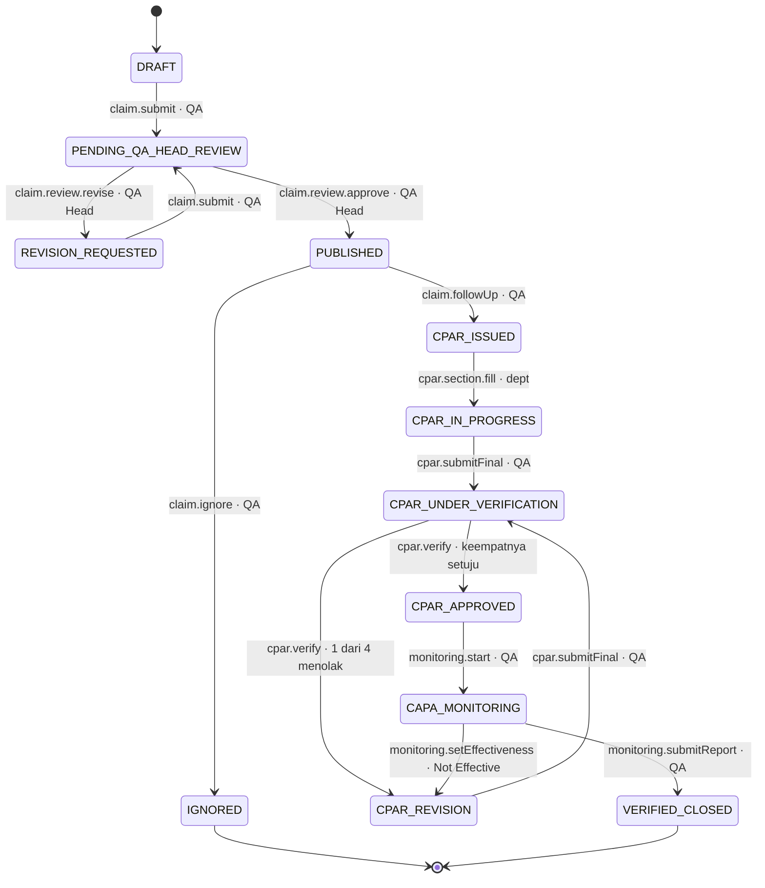
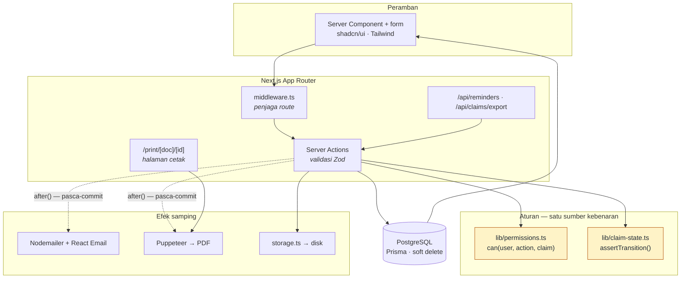

# NCC Portal — NIFCO Customer Claim

Customer Complaint Handling Portal untuk **PT Nifco Indonesia (NID)**. Menggantikan alur manual
(Excel log + email + PDF manual) dengan satu record klaim hidup yang bergerak lewat *action button*
dari input sampai `Verified Closed`.

> **Status: Fase 8 — seluruh modul jalan.** Klaim bergerak penuh dari `DRAFT` sampai
> `VERIFIED_CLOSED` lewat UI: pengisian CPAR per role, rantai verifikasi empat kapasitas,
> siklus revisi, pemantauan efektivitas CAPA, dan jalur Not Effective yang memulangkan
> klaim ke pengisian. Kelima PDF §9 tercetak dan keempat belas notifikasi §8 terkirim
> (tiga di antaranya oleh pengingat terjadwal). Dilengkapi dashboard, daftar klaim
> tersaring, ekspor Excel, dan CRUD data acuan.
>
> Diuji oleh **439 unit test** (`pnpm test`) dan **12 uji E2E** (`pnpm test:e2e`) yang
> menjalankan satu klaim melewati seluruh rantai lewat peramban sungguhan, termasuk
> skenario Not Effective.
>
> Rujukan rancangan: [`PLAN.md`](./PLAN.md) (skema Prisma final, matriks permission, diagram state)
> dan [`ASSUMPTIONS.md`](./ASSUMPTIONS.md) (aturan bisnis yang diasumsikan).

## Empat proses inti

1. **Issue Customer Claim Information** — pencatatan klaim, review & approval QA Head, distribusi
   notifikasi + PDF (*Bad News Information Form*, *Quick Information for Abnormal Part*).
2. **Issue Problem Countermeasure Request (CPAR)** — penetapan penanggung jawab dan penerbitan CPAR ID,
   atau penutupan klaim sebagai *Ignored*.
3. **CPAR Filling & Evidence Collection** — pengisian CPAR multi-departemen per section, upload evidence,
   rantai verifikasi berjenjang dengan siklus revisi.
4. **CAPA Implementation Monitoring** — monitoring efektivitas countermeasure sampai `Verified Closed`.

## Prinsip

- **Satu klaim = satu record hidup.** Semua dokumen adalah turunan data yang sama, bukan file terpisah.
- **Action button–driven.** Tombol muncul kondisional sesuai status × role.
- **Tidak ada state yang bisa dilompati.** Validasi transisi ada di server, bukan sekadar tombol disembunyikan.
- **Setiap perpindahan status** menulis `AuditLog` dan meng-enqueue notifikasi email.

## Tech stack

| Layer | Pilihan |
|---|---|
| Framework | Next.js 15 (App Router, Server Actions, TypeScript strict) |
| Styling | Tailwind CSS v4 + shadcn/ui |
| Database | PostgreSQL + Prisma ORM |
| Auth | Auth.js (NextAuth v5), credentials + bcrypt, session JWT |
| Form & validasi | react-hook-form + Zod (skema dipakai ulang client & server) |
| Tabel | TanStack Table (server-side) |
| Storage | lokal `/storage/uploads/{claimNo}/...`, diabstraksi `lib/storage.ts` |
| PDF | Puppeteer merender route `/print/[doc]/[id]` |
| Email | Nodemailer + React Email, dibungkus `lib/mailer.ts` |
| Cron | node-cron di worker terpisah (`worker/index.ts`) |
| Charting | Recharts |
| Testing | Vitest (state machine + Zod) · Playwright (E2E) |

## Setup

Prasyarat: Node.js ≥ 20.11, pnpm 10, Docker (untuk Postgres & MailHog).

```bash
pnpm install                  # postinstall menjalankan prisma generate
pnpm env:init                 # membuat .env dan mengisi AUTH_SECRET
pnpm db:up                    # Postgres :5432 + MailHog :8025
pnpm db:migrate               # terapkan migrasi
pnpm db:seed                  # role, departemen, pengguna, master data, 3 klaim contoh
pnpm dev                      # http://localhost:3000
```

| Layanan | Alamat | Kredensial |
|---|---|---|
| Portal | http://localhost:3000 | lihat [Akun demo](#akun-demo) |
| Postgres | `localhost:5432` | `ncc` / `ncc`, database `ncc_portal` |
| MailHog (SMTP) | `localhost:1025` | — |
| MailHog (web) | http://localhost:8025 | — |

Seluruh email portal mendarat di MailHog selama pengembangan dan tidak pernah keluar ke penerima sungguhan.

`pnpm env:init` tidak menimpa `.env` yang sudah ada; ia hanya mengisi `AUTH_SECRET` bila masih
kosong, jadi aman dijalankan ulang. Tambahkan `--force` untuk memutar nilainya — seluruh sesi
yang sedang berjalan akan ikut berakhir karena cookie lama tidak lagi dapat diverifikasi.
Bila `AUTH_SECRET` kosong, **setiap** login gagal dengan pesan yang menyebut variabel itu;
kegagalan non-kredensial lain (mis. basis data tidak terjangkau) dibedakan dari kata sandi
salah, dan rinciannya tercatat di log server.

<details>
<summary>Tanpa Docker (mis. container CI tanpa daemon)</summary>

Jalankan PostgreSQL 16 langsung di host dengan kredensial yang sama, sehingga `DATABASE_URL`
di `.env.example` tetap berlaku apa adanya:

```bash
service postgresql start
su postgres -c "psql -c \"CREATE ROLE ncc LOGIN PASSWORD 'ncc' CREATEDB;\""
su postgres -c "createdb -O ncc ncc_portal"
```

Untuk SMTP, jalankan penangkap bawaan repo di terminal terpisah:

```bash
pnpm mail:sink        # SMTP :1025 → ./.mail, penampil web :1080
```

Email tidak pernah diteruskan ke mana pun. Isinya tersimpan sebagai `.eml` dan dapat dibaca
di <http://localhost:1080>, termasuk dari ponsel di jaringan yang sama.
</details>

<details>
<summary>Menjalankan di Android lewat Termux</summary>

Portal berjalan di Termux, tetapi **tiga komponen butuh binary native yang tidak tersedia di
Android**, jadi ada bagian yang tidak berfungsi. Ketahui ini dulu sebelum memasang:

| Komponen | Di Termux | Sebabnya |
|---|---|---|
| Next.js, Prisma Client, Auth.js | **jalan** | Prisma 7 memakai query compiler WASM, bukan engine Rust |
| PostgreSQL | **jalan** | tersedia sebagai paket Termux |
| Penangkap SMTP + template email | **jalan** | JavaScript murni |
| `prisma migrate` | **tidak** | schema-engine hanya ada untuk Linux glibc → pakai `pnpm db:apply-sql` |
| Kompresi foto (`sharp`) | **opsional** | prebuilt-nya glibc; tanpa sharp foto tersimpan tanpa kompresi |
| **Cetak PDF (Puppeteer)** | **tidak** | Chromium headless tidak tersedia di Android tanpa proot/X11 |

Artinya: pencatatan klaim, review, CPAR, RBAC, dan email berfungsi penuh; **Bad News Information
dan Quick Information tidak akan tercetak**. Portal sudah menangani itu dengan baik — kegagalan
pencetakan dicatat di log dan tidak membatalkan perpindahan status klaim.

```bash
# 1. Paket dasar
pkg update && pkg upgrade
pkg install nodejs-lts postgresql git
npm install -g pnpm

# 2. Nyalakan PostgreSQL (Termux tidak punya root, jadi datadir ada di $PREFIX)
initdb $PREFIX/var/lib/postgresql
pg_ctl -D $PREFIX/var/lib/postgresql status   # "server is running" = lewati baris berikut
pg_ctl -D $PREFIX/var/lib/postgresql start
createdb ncc_portal
psql -d ncc_portal -c "CREATE ROLE ncc LOGIN PASSWORD 'ncc' CREATEDB;"
psql -d ncc_portal -c "GRANT ALL ON SCHEMA public TO ncc;"

# 3. Ambil kode ke folder bernama ncc-portal — bukan CustomerClaimProject.
#    Namanya sengaja dibedakan: `git clone` yang tidak sengaja dijalankan dari dalam
#    folder bernama sama menghasilkan CustomerClaimProject/CustomerClaimProject, dan
#    sesudah itu `cd CustomerClaimProject` mendarat di salinan yang salah tanpa
#    ada yang terlihat keliru.
cd ~
git clone https://github.com/LuckyFCA17/CustomerClaimProject.git ncc-portal
cd ~/ncc-portal
git checkout claude/nid-customer-claim-portal-tcippa
pwd                           # harus /data/data/com.termux/files/home/ncc-portal

# 4. Pasang dependensi. Lewati build script supaya sharp tidak menggagalkan install.
pnpm install --ignore-scripts
pnpm exec prisma generate

# 5. Siapkan .env (AUTH_SECRET dibuatkan otomatis)
pnpm env:init

# 6. Terapkan migrasi tanpa schema-engine, lalu isi data awal
pnpm db:apply-sql
pnpm db:seed

# 7. Jalankan — dua proses, masing-masing di sesi Termux sendiri
#    (geser dari tepi kiri → NEW SESSION untuk membuka sesi kedua)
pnpm mail:sink                # sesi 1 · penangkap SMTP :1025 + penampil :1080
pnpm boot                     # sesi 2 · http://localhost:3000
```

`pnpm boot` adalah satu-satunya perintah yang perlu diingat untuk memakai portal. Ia
memeriksa PostgreSQL, membangun ulang **hanya bila kodenya lebih baru daripada hasil
build**, lalu melayani dalam mode produksi. Jangan pakai `pnpm dev` di ponsel — alasannya
di bagian *Unggah foto gagal* di bawah.

Buka `http://localhost:3000` di peramban ponsel yang sama. Masuk dengan akun demo di bawah.

Jalankan `termux-wake-lock` lebih dulu bila layar akan dimatikan: tanpa itu Android
menghentikan proses latar belakang dan server ikut mati.

Setiap kali Termux dibuka ulang, PostgreSQL perlu dinyalakan lagi — langkah 1–6 cukup
sekali seumur pemasangan:

```bash
termux-wake-lock
pg_ctl -D $PREFIX/var/lib/postgresql start      # lewati bila sudah jalan
cd ~/ncc-portal && pnpm boot
```

> Jalur ditulis lengkap dengan `~/`, bukan `cd ncc-portal`. Perintah relatif bergantung
> pada posisi Anda saat mengetiknya, dan bila ada folder bernama mirip di dekatnya — sisa
> klon lama, misalnya — ia mendarat di sana. Gejalanya: `Command "boot" not found`,
> karena salinan lama itu belum punya skripnya.

### `Command "boot" not found` — Anda berada di salinan yang salah

Gejalanya: `pnpm boot`, `pnpm checkup`, `pnpm db:seed` semuanya menjawab *not found*,
padahal skripnya jelas ada di `package.json`. Sebabnya bukan skripnya hilang — Anda
sedang berdiri di **folder lain**.

Ini terjadi bila `git clone` pernah dijalankan dari dalam folder bernama sama, sehingga
tersusun bersarang:

```
~/CustomerClaimProject/                      ← klon lama, tidak pernah di-pull lagi
~/CustomerClaimProject/CustomerClaimProject/ ← proyek yang sebenarnya
```

`cd CustomerClaimProject` dari home mendarat di yang **luar**. Periksa dulu:

```bash
pwd                        # Anda ada di mana?
ls package.json            # ada?
grep '"boot"' package.json # skripnya ada?
```

Rapikan sekali, lalu masalahnya tidak dapat terulang karena namanya tidak lagi sama:

```bash
cd ~
mv CustomerClaimProject/CustomerClaimProject ncc-portal   # selamatkan yang benar
rm -rf CustomerClaimProject                               # buang klon lama
cd ~/ncc-portal
pnpm repair && pnpm install && pnpm typecheck && pnpm boot
```

`mv` di sini hanya mengganti nama di sistem berkas yang sama — berjalan seketika, dan
`.env`, `storage/`, serta `node_modules` ikut terbawa utuh. Yang dibuang hanyalah klon
lama di luarnya.

**Periksa juga ke dalam.** Salinan yang tersimpan *di dalam* proyek lebih sulit dilihat.
Tandanya: `tsc` melaporkan galat pada jalur berawalan nama folder lain, dan nomor
barisnya tidak cocok dengan berkas yang sedang Anda buka —

```
CustomerClaimProject/src/emails/types.ts:45:14 - error TS2741: …
```

padahal Anda berada di `~/ncc-portal`. Berkas itu ada di
`~/ncc-portal/CustomerClaimProject/`. Buang:

```bash
pnpm checkup                       # menyebutkan salinan di dalam maupun di atas proyek
rm -rf ~/ncc-portal/CustomerClaimProject
```

Sejak `tsconfig.json` menyebut foldernya satu per satu alih-alih menyapu `**/*.ts`,
salinan seperti itu tidak lagi ikut dikompilasi — tetapi tetap sebaiknya dibuang.

### "Email atau kata sandi salah" padahal akunnya benar

Layar login sengaja menjawab satu kalimat yang sama untuk tiga keadaan — email tidak
terdaftar, akun dinonaktifkan, dan kata sandi salah — supaya tidak membocorkan email mana
yang ada di sistem. Benar untuk pemakai, tetapi membuat pemiliknya ikut buta. Pisahkan
dengan:

```bash
pnpm login:check dimas.prayoga@nifco.co.id    # cek satu akun
pnpm login:check --list                        # seluruh akun dan status aktifnya
```

Ia memakai Prisma Client dan bcrypt yang sama dengan `authorize()`, lalu menyebutkan
langkah mana yang gugur. Tiga jawaban yang paling sering muncul:

| Temuan | Artinya |
|---|---|
| `tabel User kosong` | migrasi sudah jalan tetapi seed belum. Jalankan `pnpm db:seed` — aman diulang. Sejak versi ini `pnpm boot` menolak menyala dalam keadaan itu. |
| `akun dinonaktifkan` | bukan soal kata sandi; aktifkan lewat **Data acuan → Pengguna** |
| `Gagal menghubungi basis data` | galat itu juga yang ditangkap Auth.js dan muncul sebagai "kata sandi salah" |

> **Spasi dari papan ketik ponsel.** Alamat yang benar tetapi membawa spasi di ujungnya
> dulu ditolak sebagai format tidak valid, lalu muncul di layar sebagai "Email atau kata
> sandi salah" — tanpa petunjuk bahwa yang salah hanyalah sebuah spasi. Sejak
> `src/schemas/auth.ts` menormalkan alamat sebelum memvalidasinya, spasi dan huruf besar
> tidak lagi menggagalkan login.

### Unggah foto gagal: "Failed to fetch"

Gejalanya menyesatkan. Saat memori menipis, Next mode dev **me-restart dirinya sendiri**:

```
⚠ Server is approaching the used memory threshold, restarting...
```

Restart itu memutus semua koneksi yang sedang berjalan, termasuk POST unggahan foto. Di
peramban, permintaan yang terputus tidak pernah menerima status HTTP apa pun, sehingga
muncul sebagai `TypeError: Failed to fetch` pada `fetchServerAction` — bukan sebagai pesan
kehabisan memori, dan bukan bug pada kode unggahnya.

Terukur pada portal ini: mode dev menempati **±1.723 MB** dalam keadaan diam, sedangkan
mode produksi **±287 MB** dan memuncak di **±343 MB** saat menerima foto 4,65 MB. Gunakan
**mode produksi**, bukan `pnpm dev`:

```bash
pnpm boot       # build bila perlu, lalu start
```

`pnpm boot` menjalankan `tsc` lebih dulu sebagai gerbang murah, lalu membangun dengan
pemeriksaan Next dimatikan supaya `tsc` tidak berjalan dua kali. Alasannya ongkos gagal,
bukan ongkos berhasil — terukur pada portal ini:

| Langkah | Puncak memori | Durasi |
|---|---|---|
| `next build` dengan type check + lint | 1.649 MB | 72 detik |
| `next build` tanpa keduanya | 1.699 MB | 60 detik |
| `tsc --noEmit` sendirian | **456 MB** | **3 detik** |

Baris kedua penting: melewati type check **tidak menghemat memori sama sekali** — yang
berat adalah kompilasinya. Nilainya ada di baris ketiga: galat tipe ketahuan dalam 3 detik
pada 456 MB, bukan sesudah 72 detik pada 1.649 MB.

Tiga perintah dan kapan memakainya — `pnpm boot` memilihkan dua yang terakhir:

| Perintah | Memori | Kapan |
|---|---|---|
| `pnpm dev` | ±1.723 MB **terus-menerus** | hanya saat menulis kode di mesin ber-RAM besar |
| `pnpm build` | ±1.560 MB, sekali | otomatis dijalankan `pnpm boot` bila kode lebih baru |
| `pnpm start` | ±287 MB (±343 MB saat unggah foto) | melayani; inilah yang dipakai sehari-hari |

`pnpm checkup` memeriksa sisa memori perangkat dan memperingatkan lebih dulu bila mode dev
tidak akan muat.

### Build gagal, atau menyajikan kode lama

Dua sebab, keduanya tidak menyebut dirinya sendiri di pesan galat.

**Salinan proyek ganda.** `git clone` yang dijalankan dari dalam folder bernama sama
menghasilkan `CustomerClaimProject/CustomerClaimProject`. Yang luar tidak pernah di-`git
pull` lagi, dan Next — yang menyimpulkan akar workspace dari posisi `pnpm-lock.yaml`
terdekat ke atas — ikut membaca salinan basi itu. Gejalanya: build gagal menyebut nomor
baris yang **tidak cocok** dengan berkas yang sedang Anda buka. Periksa dan bersihkan:

```bash
ls ~/pnpm-lock.yaml ~/CustomerClaimProject/pnpm-lock.yaml 2>/dev/null
rm -rf ~/CustomerClaimProject/node_modules ~/CustomerClaimProject/pnpm-lock.yaml
pnpm checkup          # memperingatkan bila masih ada salinan di folder induk
```

`outputFileTracingRoot` di `next.config.ts` sudah mengunci akar workspace ke folder
proyek, jadi peringatan "inferred your workspace root" tidak muncul lagi.

**Cache build basi.** `.next/cache` menyimpan hasil kompilasi lama, termasuk peta sumber
yang memetakan galat ke nomor baris versi lama. Setelah `git pull` yang jauh, hapus dulu:

```bash
rm -rf .next
pnpm serve
```

**`git pull` yang tidak selesai.** Di perangkat yang membunuh proses saat memori menipis,
pull dapat berhenti di tengah dan meninggalkan working tree campur: sebagian berkas sudah
versi baru, satu-dua tertinggal di versi lama. Gejalanya muncul jauh dari sebabnya —
build gagal dengan *type error* tentang properti yang "hilang", padahal di repositori
properti itu ada dan ditambahkan pada commit yang sama dengan pemakainya. Contoh nyata:

```
src/emails/types.ts:45:14
Type error: Property 'CPAR_EVIDENCE_REQUEST' is missing in type '{ … }'
            but required in type 'Record<NotificationType, string>'.
```

Tanda yang paling jelas: **nomor baris pada pesan galat tidak cocok dengan berkas yang
Anda buka**, dan galatnya menyangkut kode yang tidak pernah Anda sunting. Pada satu kasus
nyata, dua berkas berasal dari dua keadaan berbeda sekaligus — satu persis commit dari 23
Oktober, satu lagi tidak cocok dengan commit mana pun karena tertulis separuh.

Tidak ada pesan git yang muncul belakangan untuk memberi tahu bahwa checkout-nya tidak
utuh. `pnpm checkup` menyebutkannya, dan `pnpm repair` memperbaikinya:

```bash
pnpm repair --dry-run    # tunjukkan berkas mana yang akan dikembalikan
pnpm repair              # fetch → reset --hard → clean → buang .next
pnpm install             # bila package.json ikut berubah
pnpm typecheck           # 3 detik; hijau berarti isi folder sudah utuh
pnpm boot
```

`pnpm repair` aman diulang — dan memang perlu diulang bila ia sendiri ikut terbunuh di
tengah, yang pada perangkat ini bukan hal aneh.

> `git reset --hard` membuang suntingan lokal pada berkas ter-track. Pada salinan yang
> hanya dipakai menjalankan portal itu memang yang diinginkan; bila ada suntingan yang
> ingin disimpan, `git stash` lebih dulu.

Catatan terkait: bila peramban tidak menyediakan `OffscreenCanvas`/`createImageBitmap`,
foto **tidak diperkecil** sebelum dikirim dan melintas utuh — portal menampilkan
peringatan "Foto dikirim tanpa diperkecil" sekali per sesi agar sebabnya terlihat.

> **Setiap kali setelah `git pull`:**
>
> ```bash
> pnpm install          # bila package.json berubah
> pnpm serve            # prisma generate + migrasi + build + start
> ```
>
> `pnpm serve` menyelaraskan ketiga hal yang dapat tertinggal setelah `git pull` —
> Prisma Client, isi basis data, dan hasil build — lalu menjalankan portalnya. Ketiganya
> pernah menjadi sebab kegagalan yang berbeda-beda dan tidak satupun menyebut langkah
> yang terlewat, jadi digabung menjadi satu perintah yang tidak bisa setengah dijalankan.
> `pnpm build` dan `pnpm start` sendiri **tidak** menerapkan migrasi.
>
> **`prisma generate` wajib setiap kali `prisma/schema.prisma` berubah**, bukan hanya saat
> `package.json` berubah. Folder `src/generated` tidak ikut di-commit, jadi `git pull`
> tidak pernah membawanya — ia hanya berubah ketika perintah itu dijalankan. Client yang
> tertinggal tidak mengekspor enum baru, dan impor yang `undefined` meledak jauh di dalam
> Zod sebagai `Cannot convert undefined or null to object`, galat yang sama sekali tidak
> menyebut Prisma. `pnpm serve` sudah menjalankannya lebih dulu, dan `pnpm checkup`
> menyebutkan enum mana yang hilang bila sempat terlewat.
>
> `pnpm start` menyajikan isi `.next` apa adanya, jadi route yang baru ditarik belum ada
> di sana sampai `pnpm build` dijalankan lagi — gejalanya **menu yang 404 padahal kodenya
> sudah ada**. Tidak ada yang memberi tahu; build basi tetap melayani permintaan seolah
> normal. `pnpm serve` menggabungkan keduanya supaya langkahnya tidak bisa terlewat, dan
> `pnpm checkup` memperingatkan bila kode lebih baru daripada hasil build atau bila ada
> migrasi yang belum diterapkan.

Alasannya memori. `next dev` membawa compiler dan menyimpan hasil kompilasi tiap route
yang dibuka, sehingga pemakaiannya terus naik; mode produksi menyajikan berkas yang sudah
jadi. Diukur pada proyek ini:

| Mode | RSS |
|---|---:|
| `pnpm dev`, baru menyalakan, halaman login saja | 820 MB |
| `pnpm dev`, setelah membuka halaman CPAR | 1.270 MB |
| `pnpm dev`, sesi panjang dengan banyak route | 1.821 MB |
| `pnpm start`, halaman login saja | 223 MB |
| `pnpm start`, setelah mengunggah foto 8,5 MiB | 370 MB |

Android menutup proses latar belakang begitu memori menipis, dan unggahan adalah lonjakan
yang memicunya: berkasnya ditahan utuh di memori saat diterima, lalu disalin lagi saat
dikompres. Pada `pnpm dev` yang sudah memakai 1,3 GB, lonjakan itu cukup untuk membuat
Android menghentikan Termux — sesi tertutup tanpa pesan galat, karena memang bukan proses
itu yang memutuskan berhenti.

Khusus foto, lonjakan itu sudah dipangkas di sisi pengirim: peramban memperkecil gambar
ke 1600px sebelum mengunggahnya (`lib/image-downscale.ts`), jadi yang melintas tinggal
ratusan kilobyte alih-alih beberapa megabyte. Pada uji di sini, 8,53 MiB turun menjadi
926 KB — sekitar sepersepuluh. Server tetap memperkecil dan memeriksa ulang, karena
pemeriksaan di peramban bukan pengaman.

Jalankan juga `termux-wake-lock` sebelum layar dimatikan.

**Tidak bisa login?** Jalankan `pnpm checkup`. Satu perintah itu memeriksa posisi folder,
`.env`, koneksi basis data, migrasi, seed, dan SMTP sekaligus, lalu menyebut perintah
perbaikannya. Penyebab tersering di Termux adalah PostgreSQL yang belum dinyalakan
ulang setelah ponsel di-restart.

### Membuka dari peramban Android

Server `pnpm dev` sudah mendengarkan di semua antarmuka — barisnya tercetak saat start:

```
- Local:    http://localhost:3000
- Network:  http://10.81.151.112:3000    ← alamat untuk perangkat lain
```

| Dari mana | Alamat |
|---|---|
| Peramban di ponsel yang sama dengan Termux | `http://localhost:3000` |
| Ponsel, tablet, atau laptop lain di Wi-Fi yang sama | alamat **Network** di atas |

**Kosongkan `AUTH_URL` di `.env` sebelum mengakses dari perangkat lain.** Bila diisi
`http://localhost:3000`, Auth.js memakai host itu untuk seluruh redirect: login dari
peramban di perangkat lain berhasil di sisi server, lalu dilempar ke `localhost` milik
perangkat itu sendiri — dan gagal **tanpa pesan apa pun di layar**, hanya kembali ke
halaman login. Dibiarkan kosong, portal mengikuti host yang dipakai pengunjung.
`pnpm checkup` memperingatkan bila `AUTH_URL` masih menunjuk ke localhost.

Agar tautan "Open in portal" di email juga dapat dibuka dari perangkat itu, isi
`APP_URL` dengan alamat Network yang sama, lalu jalankan ulang server.

Catatan Wi-Fi: sebagian jaringan kantor dan hotspot mengaktifkan *client isolation*,
sehingga perangkat tidak dapat saling menghubungi. Bila alamat Network tidak terbuka
padahal `pnpm checkup` hijau, coba lewat hotspot ponsel.

Dua pesan yang tampak menakutkan padahal bukan kegagalan:

| Pesan | Artinya |
|---|---|
| `pg_ctl: another server might be running` · `lock file "postmaster.pid" already exists` | PostgreSQL **sudah** jalan. Pastikan dengan `pg_ctl -D $PREFIX/var/lib/postgresql status`, lalu lanjutkan |
| `pg_ctl: could not start server` setelah pesan di atas | Yang gagal adalah menyalakan server **kedua**, bukan yang pertama |

Sebaliknya, pesan yang sering terlewat: `pnpm` apa pun yang dijalankan dari luar folder
proyek berhenti dengan "No package.json found". Bila itu terjadi pada langkah 6, tabel
tidak pernah terbentuk dan gejalanya baru muncul saat login. `pnpm checkup` mencetak folder
kerjanya di baris pertama supaya hal ini kelihatan.

Bila `doctor` melaporkan tabel inti tidak ada padahal migrasi tercatat sudah
diterapkan, catatan migrasi tidak lagi sejalan dengan isi basis data:

```bash
pnpm db:apply-sql --repair   # ulangi dari awal; schema harus sudah kosong
pnpm db:apply-sql --reset    # bangun ulang dari nol — SELURUH DATA HILANG
pnpm db:seed
```

`pnpm db:apply-sql` menjalankan berkas `prisma/migrations/*/migration.sql` yang sama persis dengan
yang dipakai `prisma migrate`, satu migrasi satu transaksi, lalu mencatatnya di `_prisma_migrations`
dengan checksum yang sama. Basis data hasilnya tetap dianggap mutakhir oleh `prisma migrate status`
di mesin biasa — bukan jalur bercabang yang nanti bentrok. Perintah ini idempotent dan punya
`--dry-run`.

Bila ingin kompresi foto aktif, pasang `libvips` lebih dulu lalu bangun sharp dari sumber:

```bash
pkg install libvips build-essential python
pnpm rebuild sharp
```

Tanpa itu foto tetap terunggah, hanya saja disimpan apa adanya tanpa diperkecil ke 1600px.
</details>

### Perintah

| Perintah | Kegunaan |
|---|---|
| `pnpm dev` | Server pengembangan |
| `pnpm build` | Build produksi |
| `pnpm typecheck` | `tsc --noEmit` (TypeScript strict, tanpa `any`) |
| `pnpm lint` | ESLint |
| `pnpm test` | Unit test Vitest |
| `pnpm test:e2e` | E2E Playwright — basis data `*_e2e` sendiri, server mode produksi di port 3100 |
| `pnpm db:up` / `pnpm db:down` | Menyalakan/mematikan Postgres + MailHog |
| `pnpm db:migrate` | `prisma migrate dev` |
| `pnpm db:seed` | Mengisi data awal (idempotent) |
| `pnpm db:studio` | Prisma Studio |
| `pnpm db:reset` | Menghapus database dan menjalankan ulang migrasi + seed |
| `pnpm db:apply-sql` | Menerapkan migrasi tanpa schema-engine (untuk Termux); `--dry-run`, `--repair`, `--reset` |
| `pnpm env:init` | Membuat `.env` dari `.env.example` dan mengisi `AUTH_SECRET` |
| `pnpm checkup` | Memeriksa folder, salinan liar, umur build, memori, `.env`, basis data, migrasi, seed, dan SMTP |
| `pnpm repair` | Menyamakan isi folder dengan commit terakhir di remote dan membuang `.next`; `--dry-run` menunjukkan dulu |
| `pnpm run doctor` | Nama lama `pnpm checkup`; **`pnpm doctor` tanpa `run` menjalankan pemeriksa milik pnpm, bukan portal** |
| `pnpm boot` | **Perintah utama untuk memakai portal**: cek basis data dan keberadaan akun, `tsc` sebagai gerbang murah, build bila kode lebih baru, lalu `start`; `--force` memaksa build |
| `pnpm serve` | `prisma generate` → migrasi → `build` → `start`; selalu membangun ulang |
| `pnpm mail:sink` | Penangkap SMTP lokal di port 1025 + penampil email di 1080 |
| `pnpm mail:test` | Mengirim satu contoh dari tiap template email; `--to`, `--only`, `--dry`, `--list` |
| `pnpm mail:width` | Mengukur ke-15 template di 320/360/414px; gagal bila ada yang meluap |
| `pnpm upload:check` | Menguji jalur simpan unggahan tanpa peramban; `--mb N` |
| `pnpm login:check <email>` | Memeriksa satu akun langsung ke basis data; `--list`, `--password` |
| `pnpm reminders` | Menjalankan tiga pengingat terjadwal lewat portal yang sedang hidup |

### Pengingat terjadwal

Tiga notifikasi tidak dipicu perpindahan status, melainkan berlalunya waktu (§8 #6, #8, #12):

| Pengingat | Kapan | Penerima |
|---|---|---|
| CPAR lewat tenggat | tiap hari, `dueDate` terlewat dan CPAR belum dikirim | departemen penanggung jawab + CFT, cc QA |
| CPAR menunggu keputusan | tiap hari, siklus verifikasi terbuka ≥ 2 hari | kapasitas verifier yang belum memutuskan |
| Periode jatuh tempo besok | tiap hari, periode pemantauan jatuh tempo H+1 | departemen penanggung jawab, cc Factory Manager |

Pemicunya sebuah route, bukan proses worker tersendiri: yang pasti berjalan di lingkungan sasaran
hanyalah server portalnya, dan proses kedua hanya menambah satu hal lagi yang bisa mati diam-diam.

```bash
pnpm env:init          # mengisi REMINDER_TOKEN bila masih kosong
pnpm reminders         # jalankan sekarang
```

Untuk menjadwalkannya, panggil alamatnya sekali sehari. Pada Linux dengan `crontab -e`:

```cron
0 8 * * * cd /path/ke/CustomerClaimProject && /usr/bin/pnpm reminders >> /tmp/ncc-reminders.log 2>&1
```

Pada Termux, `termux-job-scheduler` hanya dapat memanggil sebuah URL, jadi tokennya ikut di alamat:

```bash
termux-job-scheduler --period-ms 86400000 \
  --script "$PREFIX/bin/curl -fsS -X POST 'http://127.0.0.1:3000/api/reminders?token=TOKEN_ANDA'"
```

Dijalankan berapa kali pun hasilnya sama. `dedupeKey` tiap pengingat memuat tanggal hari ini, jadi
email kedua pada hari yang sama tidak pernah diantrekan — menjalankannya tiga kali tetap satu email
(§8 kriteria penerimaan #5). Tanpa `REMINDER_TOKEN` alamat itu menolak semua panggilan: token yang
lupa diisi tidak boleh berarti siapa pun boleh memicunya.

### Catatan komponen UI

`ui.shadcn.com` diblokir oleh network policy lingkungan pengembangan ini, sehingga CLI `shadcn add`
tidak bisa mengambil komponen. Karena shadcn/ui memang berupa komponen *copy-paste* ke dalam repo,
komponennya ditulis langsung di `src/components/ui/` di atas primitif Radix dari npm — bentuknya sama
dengan keluaran CLI. `components.json` tetap disediakan agar `pnpm dlx shadcn@latest add <komponen>`
langsung bisa dipakai di jaringan yang tidak memblokir host tersebut.

## Dokumen dan email

Setiap klaim yang dikirim mencetak dua PDF A4 lewat Puppeteer, yang merender route
`/print/[doc]/[id]` — halaman React biasa, bukan penyusun PDF terpisah. Satu sumber tata letak
untuk layar dan kertas, sehingga `?preview=1` di peramban memang menggambarkan hasil cetaknya.

| Dokumen | Format | Isi |
|---|---|---|
| Bad News Information | A4 **mendatar** | Form 5 (R3) PR-QA-ISO-07 — Quality Alert, lengkap dengan grid sosialisasi operator |
| Quick Information for Abnormal Part | A4 tegak | Foto besar berdampingan untuk ditempel di line produksi |
| Corrective & Preventive Action Report | **A3 mendatar, satu halaman** | Delapan section CPAR dalam tiga kolom, beserta fishbone, 5-Why, dan tabel action plan |
| CAPA Implementation Monitoring | A4 tegak | Periode pemantauan dan penilaian efektivitas |
| A3 Improvement Report | A4 tegak | Lima blok A3 berdampingan |

Ukuran kertas ditentukan `@page size` di CSS, **bukan** argumen `format` Puppeteer: `renderPdf`
memakai `preferCSSPageSize: true`, sehingga CSS-lah yang menang. Pasangan `@page` dan lebar
`.sheet` dipegang satu tempat — prop `size` pada komponen `Sheet` — karena bila keduanya berbeda,
pratinjau terlihat benar sementara PDF-nya terpotong, dan itu baru ketahuan setelah dicetak.

CPAR memakai A3 mendatar sejak lembarnya memuat fishbone, tabel 5-Why, dan tabel action plan:
dipadatkan ke A4 semuanya terbaca terlalu kecil, padahal lembar inilah yang ditempel saat review.
Lebar A3 dipakai sebagai **tiga kolom**, bukan satu baris selebar 400mm — baris sepanjang itu
menyulitkan mata kembali ke awal baris berikutnya.

CPAR juga harus **muat satu halaman**: lembar yang terbagi dua tidak dapat ditempel
berdampingan, dan yang paling sering dibandingkan — root cause dengan countermeasure-nya —
justru yang terpisah. Yang membuatnya muat, berurutan dari yang paling besar pengaruhnya:

- **membuang pengulangan.** Type of claim, part name, internal part no., customer, dan
  non-conformance detail dulu tercetak dua kali — di kepala lembar dan di section 1 Problem
  Description. Kelimanya kini hanya di section 1, dan satu baris selebar lembar itu yang
  paling menentukan;
- **`column-fill: balance`.** Dengan `auto`, wadah multikolom memakai seluruh sisa tinggi
  halaman walau isinya pendek, sehingga blok tanda tangan **selalu** terdorong ke halaman
  kedua — berapa pun padatnya isi;
- pemadatan tipografi dan jarak, dipusatkan di `.sheet-a3-landscape` pada `globals.css`
  supaya lembar A4 yang memakai komponen yang sama tidak ikut berubah.

Sisa ruangnya tipis — sekitar 8mm dari 297mm pada CPAR terisi penuh — dan satu action plan yang
panjang menghabiskannya. Karena itu ada **penyusutan otomatis**: `fitToOnePage()` di `lib/pdf.ts`
mengukur lembar tepat sebelum mencetak dan, bila melebihi satu halaman, mengecilkan isinya
secukupnya.

Tiga keputusan di dalamnya:

- **`zoom`, bukan `transform: scale()`.** Zoom ikut mengalirkan ulang tata letak, jadi teks yang
  menyusut memakai barisnya lebih penuh dan tingginya turun lebih banyak daripada sekadar
  diperkecil. `transform` hanya menggambar ulang kotak yang ukurannya tetap;
- **dipasang pada pembungkus isi, bukan pada `.sheet`.** Dengan begitu yang mengecil hanya isinya;
  padding lembar tetap 5mm atas–bawah dan 7mm kiri–kanan. Padding itulah margin cetaknya, dan
  sebagian besar printer kantor tidak dapat mencetak lebih dekat dari itu ke tepi kertas;
- **dicari lewat bagi dua, bukan sekali hitung.** Karena zoom mengalirkan ulang teks, tinggi tidak
  berbanding lurus dengan faktornya — sekali hitung meleset. Yang dicari pun faktor *terbesar*
  yang masih muat, bukan yang pertama kebetulan muat: menyusut berlebihan menyisakan lembar
  setengah kosong dengan huruf lebih kecil daripada seharusnya. Tujuh kali bagi dua, seluruhnya
  perhitungan tata letak di dalam peramban — tidak ada pencetakan ulang.

Batas bawahnya **65%** (huruf 7,5pt menjadi sekitar 4,9pt). Di bawah itu lembar memang muat satu
halaman tetapi tidak lagi terbaca dari jarak papan, yang justru alasan ia dicetak A3 — lebih baik
dua halaman yang terbaca. Bila batas itu tercapai dan isinya masih meluap, lembar dicetak apa
adanya dan sebuah peringatan masuk log server.

Terukur pada CPAR tiruan yang isinya dilipatgandakan: dua kali lipat muat pada 80%, tiga kali
lipat pada 70%, dan empat kali lipat — 20 baris permanent countermeasure, 16 faktor root cause —
menembus batas bawah. `pnpm pdf:check` ikut memeriksa jumlah halaman supaya hal ini tidak lolos
diam-diam.

```bash
pnpm pdf:check --claim <claimId>              # ukuran kertas + jumlah halaman kelima dokumen
pnpm pdf:check --claim <claimId> --out ./pdf  # sekalian simpan berkasnya
```

Perlu Chromium; di Termux tidak ada, jadi perintah ini hanya jalan di mesin yang punya.

Lembar Bad News meniru formulir terkendali NID apa adanya: urutan baris Section A, pembagian
Section B standard–actual, pita peringatan berbahasa Indonesia yang sudah tercetak di sana, sampai
ejaan "PROBLEM HYSTORY" — itu teks pada dokumen terkendali, dan memperbaikinya justru membuat
lembar portal berbeda dari master yang dipegang auditor.

**Section C — Socialization** adalah grid paraf: tiga grup kerja (A, B, C) masing-masing berkolom
GROUP / DEPT / OPERATOR / PARAF, ditambah blok OTHERS untuk *Related Section Process Control*.
Barisnya sengaja dicetak kosong — lembar ini diedarkan ke lantai produksi dan diparaf operator
dengan tangan, persis seperti formulir aslinya.

Kolom PREPARED dan APPROVED diisi portal beserta waktu persetujuan digitalnya. CHECKED,
ACKNOWLEDGED (QC / PPIC / PRODUCTION), dan RESPONSIBLE dibiarkan kosong: portal tidak mengetahui
siapa yang memaraf di lapangan, dan mengisinya dengan tebakan akan membuat lembar itu berbohong.

Dokumen dicetak ulang setelah klaim disetujui supaya blok tanda tangan memuat nama dan waktu
persetujuan QA Dept. Head. Versi lama tidak ditimpa — nomor versinya naik, dan setiap PDF
menyimpan snapshot data klaim saat dicetak.

Halaman cetak dibuka Puppeteer memakai token bertanda tangan berumur dua menit yang terikat satu
dokumen dan satu klaim, karena Puppeteer tidak membawa cookie sesi. Manusia membukanya dengan
sesi biasa lewat `?preview=1`.

Email keluar hanya lewat `lib/mailer.ts`, tercatat di tabel `Notification`, dan dikirim **setelah**
transaksi perpindahan status commit — SMTP yang mati tidak membatalkan perubahan status, dan
transaksi yang gagal tidak menyisakan email yang terlanjur keluar. Log pengirimannya ada di
`/notifications` untuk QA Dept. Head dan Administrator.

## Action button

Alur berpindah tahap lewat tombol yang muncul kondisional menurut status × role, bukan menu tetap.
Tombol yang terlihat selalu merupakan turunan `availableTransitions()` dan matriks izin — bukan
daftar yang ditulis ulang di tiap halaman.

| Tombol | Muncul saat | Untuk |
|---|---|---|
| Submit claim information | `DRAFT`, `REVISION_REQUESTED` | QA pembuat klaim |
| Review claim information | `PENDING_QA_HEAD_REVIEW` | QA Dept. Head |
| **Action Button A** — Claim follow up / Ignore claim | `PUBLISHED` | QA, QA Dept. Head |
| **Action Button B** — CPAR form | `CPAR_ISSUED` dan sesudahnya | semua yang boleh melihat klaim |

Kedua jalur Action Button A saling menutup: begitu CPAR terbit klaim tidak bisa lagi di-ignore, dan
sebaliknya. Yang menjamin itu state machine di server, bukan tombol yang disembunyikan.

Tenggat pengisian CPAR bawaannya tiga hari kerja dan selalu dinormalkan ke pukul 17:00 WIB —
`<input type="date">` hanya mengirim tanggal, sehingga tanpa normalisasi tenggat akan terhitung
lewat sejak pukul 07:00 pagi hari H.

## Akun demo

Semua akun hasil seed memakai kata sandi **`Nifco#2026`**.

| Email | Nama | Role | Dept |
|---|---|---|---|
| `rina.kusuma@nifco.co.id` | Rina Kusuma | QA Dept. Head + QA Staff | QA |
| `dimas.prayoga@nifco.co.id` | Dimas Prayoga | QA Staff | QA |
| `sari.wulandari@nifco.co.id` | Sari Wulandari | QA Staff | QA |
| `bambang.setiawan@nifco.co.id` | Bambang Setiawan | User Dept. Head + User Dept. | PRD |
| `yusuf.ramadhan@nifco.co.id` | Yusuf Ramadhan | User Department | PRD |
| `anita.rahmawati@nifco.co.id` | Anita Rahmawati | User Dept. Head + User Dept. | ENG |
| `hendra.gunawan@nifco.co.id` | Hendra Gunawan | User Department | ENG |
| `lestari.ningsih@nifco.co.id` | Lestari Ningsih | User Dept. Head + User Dept. | PPIC |
| `agus.salim@nifco.co.id` | Agus Salim | User Department | MTC |
| `toshiro.tanaka@nifco.co.id` | Toshiro Tanaka | Factory Manager | — |
| `kenji.yamamoto@nifco.co.id` | Kenji Yamamoto | President Director | — |
| `fajar.nugroho@nifco.co.id` | Fajar Nugroho | Administrator | — |

Beberapa akun sengaja rangkap jabatan (§3), karena di lapangan hal itu lumrah.

Seed juga membuat 3 klaim contoh pada status berbeda — `DRAFT`, `PENDING_QA_HEAD_REVIEW`, dan
`CPAR_IN_PROGRESS` (CPAR bertipe CFT: Production sebagai Main Responsible Department, Engineering
sebagai anggota).
Masuk sebagai Yusuf (PRD) dan Agus (MTC) menghasilkan daftar klaim yang berbeda — itulah aturan
visibilitas §3 yang bekerja.

### Catatan paket email

`@react-email/components` ditandai npm sebagai *no longer supported* pada seluruh versinya, jadi
yang dipakai hanya `@react-email/render` — perender React Email yang masih didukung. Primitif
email (shell, tabel ringkasan, tombol) ditulis sendiri di `src/emails/primitives.tsx` memakai
tabel dan atribut lawas, karena klien email korporat tidak dapat diandalkan untuk flexbox.

### Menguji email dari ponsel Android

Ada dua pertanyaan berbeda, dan setelannya tidak sama.

**"Apakah emailnya benar?"** — isi, tautan, dan ke-15 tampilannya. Jawabannya tidak perlu
relay sungguhan:

```bash
pnpm mail:sink                          # terminal 1 · SMTP :1025 + penampil :1080
pnpm mail:test --to apa@pun.test        # terminal 2 · satu contoh tiap template
```

Ke-15 email mendarat di penampil. Buka alamat LAN yang tercetak saat `mail:sink` start dari
peramban ponsel; ada pengubah lebar 360/414px untuk melihat tata letaknya pada ukuran ponsel,
beserta versi teks, sumber `.eml`, dan lampirannya.

**"Apakah tampilannya benar di aplikasi Gmail Android?"** — ini hanya terjawab di kotak masuk
Gmail sungguhan, karena yang diuji justru mesin render Gmail: ia membuang sebagian CSS,
memaksa mode gelap, dan memotong email di atas 102KB. Arahkan SMTP ke relay:

```bash
SMTP_HOST=smtp.gmail.com                # App Password, bukan sandi akun
SMTP_PORT=465
SMTP_SECURE=true
SMTP_USER=anda@gmail.com
SMTP_PASSWORD=xxxxxxxxxxxxxxxx
MAIL_FROM="NCC Portal <anda@gmail.com>"
```

```bash
pnpm mail:test --to anda+ncc@gmail.com --yes
```

`--yes` wajib begitu `SMTP_HOST` bukan loopback: satu perintah mengirim 15 email sungguhan,
dan alamat seed portal ini berakhiran `@nifco.co.id` yang bisa jadi domain aktif. Ganti dulu
alamat akun demo lewat **Data acuan → Pengguna** menjadi alias `anda+qa@gmail.com`,
`anda+prod@gmail.com`, dan seterusnya — Gmail mengantar semuanya ke satu kotak masuk, tetapi
header `To:` tetap berbeda sehingga terlihat peran mana yang dinotifikasi.

> **`APP_URL` wajib dapat dijangkau ponsel.** Tombol di dalam email menunjuk ke sana. Bila
> portal berjalan di laptop, isi `APP_URL` dengan IP LAN laptop dan **kosongkan `AUTH_URL`**;
> bila portal berjalan di ponsel lewat Termux, `http://localhost:3000` justru benar.
> `pnpm checkup` memeriksa keduanya.

Yang tidak diuji `mail:test`: **siapa** penerimanya dan **kapan** emailnya dipicu. Itu logika
`src/server/claim-notifications.ts`, dan hanya terbukti dengan menjalankan alur klaim sungguhan
lalu membandingkannya dengan halaman `/notifications`.

### Lebar email di ponsel

```bash
pnpm mail:width                    # ke-15 template, 320/360/414/800px
pnpm mail:width --shots .shots     # simpan tangkapan layar 360px
```

Kartu email bersifat cair (`width:100%`) dengan batas 600px pada div pembungkus, bukan tabel
selebar 600px. Perbedaannya tidak kelihatan di desktop dan menentukan segalanya di ponsel:
versi lama memakai `width="600"` dengan `max-width:100%`, dan `max-width` itu tidak pernah
bekerja karena sel induknya ikut melebar mengikuti isinya — 100% selalu berarti 600px. Di layar
360px email menjadi 624px, lalu klien ponsel memperkecil seluruh email agar muat. Gejalanya
bukan pesan galat, melainkan huruf yang mengecil.

Outlook pada Windows memakai mesin Word, yang mengabaikan `max-width` sepenuhnya. Penyeimbangnya
adalah *ghost table* 600px di dalam `<!--[if mso]>`, dipasang pada HTML jadi oleh
`withOutlookGhostTable()` karena React tidak dapat menghasilkan simpul komentar. Keberadaannya
dijaga `tests/unit/email-shell.test.ts`; lebarnya sendiri hanya dapat dibuktikan dengan mengukur,
dan itulah tugas `pnpm mail:width`.

## Kontrol akses

RBAC ditegakkan di tiga lapis, dengan `src/lib/permissions.ts` sebagai sumber kebenaran tunggal:

1. **`src/middleware.ts`** — penjaga route per prefix (mis. `/master` hanya ADMIN). Tidak menyentuh
   database; role dibaca dari JWT, sehingga aman berjalan di edge runtime.
2. **Server action** — `assertCan(actor, action, claim)` melempar `ForbiddenError` (403) sebelum
   perubahan apa pun terjadi. Ini yang benar-benar mengamankan sistem.
3. **UI** — tombol yang tidak relevan disembunyikan. Ini kenyamanan, bukan pengaman.

Matriks `ACTION × ROLE × STATUS` selengkapnya ada di [`PLAN.md` §2](./PLAN.md#2-matriks-permission-action--role--status).

### Menyunting klaim: dua hak, bukan satu

| Aksi | Status | Perilaku |
|---|---|---|
| `claim.update` | `DRAFT`, `REVISION_REQUESTED` | Auto-save tiap 30 detik, **tanpa** audit log (asumsi A-17) |
| `claim.amend` | `PUBLISHED`, `CPAR_ISSUED`, `CPAR_IN_PROGRESS`, `CPAR_REVISION` | Simpan manual, audit log per field, dokumen dicetak ulang |

Keduanya dipisah karena peristiwanya berbeda. Draft belum menjadi apa pun bagi siapa pun;
mencatat tiap auto-save hanya akan menenggelamkan timeline klaim. Klaim yang sudah terbit
dibaca dan dikerjakan departemen lain, jadi tiap perubahannya dicatat beserta **nilai lamanya** —
pertanyaan auditor selalu "sebelumnya tertulis apa", dan tanpa itu jawabannya sudah tertimpa.

Daftar statusnya berhenti sebelum verifikasi, dan itu disengaja:

- **`CPAR_UNDER_VERIFICATION` tidak termasuk.** Empat verifier sedang memutuskan atas isi yang
  terpampang; mengubahnya di tengah jalan membuat sebagian memutuskan atas dokumen yang berbeda
  dari sebagian lainnya, tanpa seorang pun tahu;
- **`CPAR_APPROVED` dan sesudahnya juga tidak.** Tanda tangan sudah diberikan atas problem yang
  dinyatakan. Mengubah pernyataan itu setelahnya membuat blok tanda tangan di lembar CPAR
  menjaminkan sesuatu yang tidak pernah dibaca penandatangannya. Jalurnya REVISE dari verifier —
  siklus naik dan semua memeriksa ulang, yang memang maksudnya.

**CPAR tidak perlu disalin ulang.** Section 1 CPAR membaca klaimnya langsung
(`server/cpar-problem.ts`), jadi perbaikan pada Claim Information langsung terbaca di sana.
Yang tidak ikut berubah sendiri adalah PDF, karena ia snapshot — karena itu `claim.amend`
mencetak ulang Bad News, Quick Information, dan CPAR dengan nomor versi naik, dan versi lamanya
tetap tersimpan.

Yang ditulis hanya field yang benar-benar berubah. Formulir mengirim seluruh isian tiap kali
disimpan, jadi tanpa perbandingan per field audit log akan mencatat tiga puluh "perubahan" untuk
satu kata yang disunting — dan kolom tanggal akan ternormalkan jamnya tanpa ada yang meminta.

### Mencetak lembar klaim

Tombol **Print Bad News Information** dan **Print Quick Information** di halaman klaim menautkan
ke halaman cetaknya (`/print/<doc>/<id>?autoprint=1`), bukan memanggil pembuat PDF di server.
Halaman itu dirender peramban yang sedang dipakai, jadi tidak perlu Chromium di server — di
Termux tidak ada — dan hasilnya keluar seketika. `authorizePrint` menerima sesi pengguna,
sehingga tautannya tidak memerlukan token. Draft tidak ditawari: isinya baru lengkap setelah
submit.

## State machine klaim

`src/lib/claim-state.ts` memuat satu-satunya daftar perpindahan status yang sah. Perpindahan
yang tidak ada di tabel itu ditolak dengan `IllegalTransitionError` (HTTP 409), termasuk ketika
server action dipanggil langsung tanpa lewat UI.

Pemeriksaan role sengaja dilakukan dua kali, oleh dua tabel berbeda:

| Lapis | Pertanyaan yang dijawab | Berkas |
|---|---|---|
| `assertCan` | Boleh melakukan aksi ini, pada klaim ini, pada status ini? | `lib/permissions.ts` |
| `assertTransition` | Perpindahan status ini sah bagi kapasitas tersebut? | `lib/claim-state.ts` |

Keduanya harus lolos, sehingga satu kekeliruan di salah satu tabel tidak cukup untuk melompati
tahap. `tests/unit/claim-state.test.ts` memeriksa seluruh 144 pasangan status: 14 yang sah harus
diterima, 130 sisanya harus ditolak.

## Diagram alur status

Empat belas perpindahan yang sah, dengan kapasitas yang boleh memicunya. Diagram ini
dijaga `tests/unit/readme-diagram.test.ts`: bila `src/lib/claim-state.ts` berubah tanpa
diagramnya ikut diperbarui, unit test gagal — supaya gambar ini tidak pelan-pelan
berbohong seiring kode bergerak.



Dua lingkaran yang membuat portal ini bukan sekadar daftar status: `CPAR_UNDER_VERIFICATION
⇄ CPAR_REVISION` (verifier menolak, siklus naik, verifikasi diulang dari awal) dan
`CAPA_MONITORING → CPAR_REVISION` (countermeasure terbukti tidak efektif di lapangan,
sehingga analisisnya dibuka kembali).

Empat kapasitas verifier wajib itu — QA Dept. Head, User Dept. Head, Factory Manager,
President Director — tidak seluruhnya berasal dari role. Kapasitas **User Dept. Head
ditunjuk per CPAR**, dipilih dari anggota Main Responsible Department saat CPAR diterbitkan,
dan disimpan di `Cpar.userHeadVerifierId`.

Alasannya ditemukan di produksi: ada departemen yang tidak punya satu pun pemegang role
`USER_HEAD` — QA, misalnya. CPAR yang penanggung jawabnya departemen itu berhenti selamanya
pada tiga dari empat keputusan, tanpa apa pun di layar yang menyebutkan apa yang kurang.
Dua akibat lanjutannya ikut ditangani: satu orang kini dapat memegang dua kapasitas sekaligus
(QA Dept. Head yang juga ditunjuk sebagai User Dept. Head memutuskan dua kali, sekali untuk
tiap kapasitas, dan rantai mencatat keduanya terpisah), dan kapasitas yang dipakai dikirim
eksplisit lalu diperiksa ulang di server — bukan ditebak dari role pengirimnya.

## Diagram arsitektur



Tiga hal yang diperlihatkan diagram ini dan mudah hilang dari pandangan saat membaca kode:

- **Aturan dipanggil dari server action, bukan dari komponen.** UI menyembunyikan tombol
  sebagai kesopanan; yang menolak perbuatan adalah `can()` dan `assertTransition()`.
- **Email dan PDF berjalan sesudah transaksi commit** (`after()`, panah putus-putus).
  SMTP yang mati tidak membatalkan perpindahan status, dan transaksi yang di-rollback
  tidak menyisakan email yang terlanjur keluar. Penulisan berkas tidak begitu: ia terjadi
  di dalam aksi (panah utuh), karena jalur penyimpanannya harus sudah pasti sebelum
  barisnya ditulis ke basis data.
- **Halaman cetak adalah route biasa.** PDF dirender dari `/print/[doc]/[id]`, sehingga
  `?preview=1` di peramban benar-benar menggambarkan hasil cetaknya.

## Progres fase

- [x] **Fase 0** — Scaffold, shell UI, login, docker-compose
- [x] **Fase 1** — Prisma schema, migrasi, seed, Auth.js + RBAC
- [x] **Fase 2** — State machine + unit test, Modul 1
- [x] **Fase 3** — PDF Bad News & Quick Info, mailer, template email
- [x] **Fase 4** — Modul 2 (Follow Up / Ignore, CPAR ID)
- [x] **Fase 5** — Modul 3 (CPAR form, verifikasi, siklus revisi)
- [x] **Fase 6** — Modul 4 (monitoring, Not Effective, Verified Closed)
- [x] **Fase 7** — Worker cron, dashboard, claim list, master data
  - [x] Claim list server-side: pencarian, filter, urutan, paginasi
  - [x] Dasbor CPAR: daftar tersaring + tabel action/evidence pending
  - [x] Pengingat terjadwal (§8 #6, #8, #12)
  - [x] Master data CRUD — delapan daftar acuan
  - [x] Ekspor Excel daftar klaim (membawa penyaring yang sedang berlaku)
  - [x] Dashboard + grafik (kartu ringkas, klaim per bulan, pareto NC detail, tabel tindakan)
- [x] **Fase 8** — E2E Playwright, README final
  - [x] Harness E2E: basis data + penyimpanan sendiri, server mode produksi di port 3100
  - [x] Happy path penuh: draft kosong → Verified Closed (12 uji, satu klaim berurutan)
  - [x] Skenario Not Effective: siklus naik, verifikasi diulang, lalu ditutup
  - [x] README final + diagram state & arsitektur (Mermaid, dijaga unit test)
